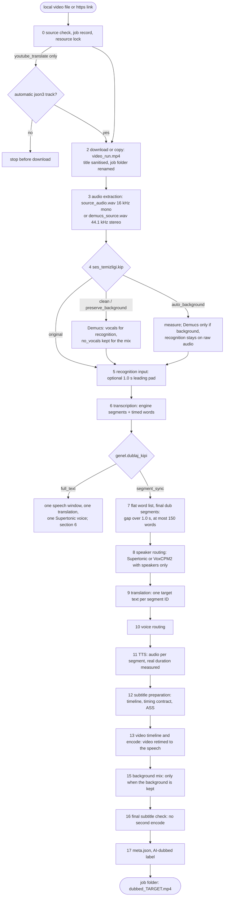

# End-to-end pipeline flow: from a link or a local file to the delivered dub

One page that follows a dubbing job from step 0 (a link or a local video file) to the moment the dubbed video lies in
its job folder: every stage, the file it reads, the file it writes, what changes in between, which setting changes the
path, and why the transcript is cut into word times and grouped again. Türkçe: [../muhendislik/hat_akisi.md](../muhendislik/hat_akisi.md).

This page is the spine; the depth lives in the stage pages and is linked, not copied: [architecture](../mimari.md),
[timing sources](timing-sources.md), [pinned values](pinned-values.md), [speakers and segments](speakers_and_segments.md),
[translation](translation.md), [TTS timing and mix](tts_timing_and_mix.md),
[video, subtitles and resume](video_subtitles_and_resume.md), [engine pages](../motorlar/), [ADRs](../adr/README.md).

Evidence labels as in [README.md](README.md): **measured**, **documented**, **no record**. Code references are
`file:line` relative to `src/dublaj_hatti/`; `dubber.py` means `bolum_00_omurga/core/dubber.py`. Line numbers were taken
when this page was written and may drift; the function names stay valid.

## 1. Map

The default job is `dubla <video>` with `genel.dublaj_kipi = "segment_sync"`. Numbers are the checkpoint order in
`bolum_00_omurga/core/asama_sozlesmesi.py` (the stage registry; order 14 is not used).

## 2. Step 0: entry, job and job folder

| Item | Behaviour | Code |
|---|---|---|
| Accepted source | a local file with extension `.mp4 .mkv .mov .webm .avi .m4v`, or an `https` link; a video-site link needs yt-dlp (extras `youtube`), a gallery link needs gallery-dl (extras `galeri`); a missing tool is an install hint, not a stack trace | `kaynak_girdisi.py:42` |
| Entry points | CLI, desktop and web interfaces add a job to the job store and run it through one runner; the Python API calls the pipeline directly without a job store | `is_yonetimi/calistirici.py:86`, `api.py:563` |
| Gates before the pipeline | setting validation and combination rules ([kombinasyonlar](../tarifler/kombinasyonlar.md)), the licence gate, then a resource lock: `gpu` on CUDA, `cpu_agir` otherwise | `is_yonetimi/calistirici.py:92-126` |
| json3 pre-flight | only with `transkripsiyon.motor = "youtube_translate"`: the automatic caption track is probed before anything is downloaded; skipped on resume | `dubber.py:4679`, `dubber.py:183` |
| Output root | `cikti/` in the project root; changed by `genel.cikti_klasoru` (`--cikti`) or the environment variable `DUBLAJ_OUTPUT_DIR`; the job store lives in `<root>/_is_deposu/` | `bolum_00_omurga/runtime/output_paths.py:9-45`, `is_yonetimi/depo.py:95` |
| Job folder | created as `run_<YYYYmmdd_HHMMSS>`; after stage 2 it is renamed `<sanitised title, at most 50 characters>_<same timestamp>` | `dubber.py:2015`, `dubber.py:4732-4760` |
| Resume | when the job folder already holds `pipeline_state.json`, the runner passes it as `resume_run_dir`; the folder must lie under the output root | `is_yonetimi/calistirici.py:129-131`, `dubber.py:4678-4691` |

## 3. Stage table (segment sync, the default)

Every stage writes its result into the job folder and records it in `pipeline_state.json` with an input fingerprint and
a contract version ([ADR 0012](../adr/0012-stage-checkpoints-and-resume.md)); "v" below is that contract version.

| # | Stage id (v) | Input | Output in the job folder | What changes | Code |
|---|---|---|---|---|---|
| 2 | `video_indirme_veya_kopyalama` (1) | link or local path | `video_run.mp4` (fixed name; bytes copied, container unchanged) | link: yt-dlp picks ≤ 1080p, H.264 first, no playlist, 4 GiB cap, one retry on timeout/403; gallery: gallery-dl in a separate process; local: copy. Also collected: title and, for links only, the platform language | `bolum_10_kaynak_edinme/adim_20_kaynak_alma/source_video.py:12`, `youtube_downloader.py:61-98` |
| 2a | (no checkpoint) file-name safety and video info | title | job folder name | NFKC, emoji removed, letters transliterated to ASCII, lower case, Windows-reserved names guarded, ≤ 50 characters; ffprobe information is logged only | `adim_10_dosya_adi_guvenligi/filename_sanitizer.py:111`, `dubber.py:4792` |
| 3 | `kaynak_ses_cikarma` (1) | `video_run.mp4` | `source_audio.wav` (16 kHz mono) or `demucs_source.wav` (44.1 kHz stereo when Demucs runs on purpose) | container → PCM; inverted-phase stereo is repaired before a mono downmix | `dubber.py:1017-1029`, `adim_40_ses_cikarma/audio_extractor.py:60` |
| 4 | `demucs_vokal_ayirma` (2) | the WAV from stage 3 | `demucs/htdemucs/demucs_source/vocals.wav`, `no_vocals.wav`, `clean_source.wav`, `asr_ready.wav`; with `auto_background` also `arka_plan_olcumu.json` | splits speech from background; which file feeds recognition depends on `ses_temizligi.kip` (section 5) | `dubber.py:4817-4871`, `dubber.py:1042-1115` |
| 5 | `asr_sesi_hazirlama` (1) | recognition input | `asr_leading_pad.wav` or the same file | 1.0 s of silence in front for the engines listed in `ASR_LEADING_PAD_ENGINES`; the duration is checked (± 0.05 s) and every time is shifted back by 1.0 s after recognition | `dubber.py:140-156`, `dubber.py:901-1006` |
| 6 | `transkripsiyon` (1) | stage 5 audio | `pipeline_transcription_result.json` (`segments`, `source_lang`, `alignment`) + engine evidence (`<engine>_HAM_segmentleri.txt`, CTC and profile reports) | audio → engine segments and timed words; times from the engine's time source ([timing-sources.md](timing-sources.md)); language order: platform metadata > `transkripsiyon.kaynak_dil` > automatic detection ([dil_tespiti.md](../tarifler/dil_tespiti.md)); the language the engine reports is used from here on | `dubber.py:4897-4978`, `dubber.py:3081` |
| 7 | `forced_alignment_ve_nihai_segmentler` (1) | stage 6 result | `pipeline_final_segments_result.json` | engine segments are dropped; the flat word list is regrouped into dub segments (section 4) | `dubber.py:4980-5023`, `bolum_30_hizalama_ve_segment/nihai_dublaj_segmentleri.py:250` |
| 7a | (no checkpoint) source-side texts | final segments | `nihai_kaynak_dublaj_segmentleri.txt`, `transcript_<src>.txt`, `full_paragraf_<src>.txt`, `transcript_word_level.txt`, source subtitle HTML preview | readable copies for inspection; a global word-overlap check runs here | `dubber.py:5099-5122` |
| 8 | `konusmaci_yonlendirme` (2) | final segments + stage 4 recognition audio | `pipeline_speaker_routing_result.json`, `supertonic_tts/konusmaci_secimi/` (`speaker_timeline.json`, `speaker_segment_split_report.json`, `speaker_voice_map.json`, …) | only with `ses.motor = "supertonic"` and speakers on: 3D-Speaker, a segment is split at speaker changes inside it, segments are renumbered, each speaker gets a voice; otherwise skipped | `dubber.py:5055-5098`, `bolum_50_seslendirme/supertonic_tts/konusmaci_secimi/router.py:82-160` |
| 9 | `ceviri` (2) | segments (source text) | `pipeline_translation_result.json` | text replaced by the target text per segment ID; times untouched; the source text kept as `original_source_text`; a count mismatch stops the job | `dubber.py:5136-5210` |
| 10 | `ses_yonlendirme` (2) | translated segments | `pipeline_voice_routing_result.json`, `full_paragraf_<tgt>.txt`, `translated_segments_<tgt>.txt` | Supertonic: voice and fixed speed per segment; other engines: recorded only | `dubber.py:5211-5267` |
| 11 | `tts_ve_segment_sesleri` (2) | voice-routed segments | `pipeline_tts_result/manifest.json`, `mixed_audio.wav`, `segment_audios/segment_<n>.wav`, then `dubbed_<tgt>.wav` | text → audio per segment; the real duration is measured; optional atempo; generated speech is aligned for subtitle times | `dubber.py:5269-5332`, `dubber.py:1288` |
| 12 | `altyazi_hazirlama` (1) | TTS manifest + video | `pipeline_subtitle_result.json`, `subtitle_timing_contract.json`, `burnin_<mode>_<lang>.ass`, `audio_new_timeline.wav` | with `altyazi.mod` ≠ `none`: the new timeline is computed early so subtitles can be burned in the single encode; optional smart frame produces the visual video | `dubber.py:5333-5399`, `dubber.py:499` |
| 13 | `video_timeline_ve_final_mux` (2) | video + segment audios + timing | `dubbed_<tgt>_base_mux.mp4`, `audio_new_timeline.wav`, `pipeline_video_mux_result.json`, `video_segments.json` | per segment `video_speed = original / TTS duration`; gaps kept at speed 1.0; segment start/end replaced by the new timeline; one encode (CQ or `max_mb`) with subtitles | `dubber.py:5401-5503`, `bolum_60_video_ve_encode/timeline_ve_final_encode/video_processor.py:190-337` |
| 15 | `arka_plan_miksi` (2) | `no_vocals.wav` + timeline | `dubbed_<tgt>_background_stage.mp4`, `pipeline_background_result.json` | only when the background is kept: the background gets the same trims and speeds as the video, then `amix` under the dub; skipped otherwise | `dubber.py:5509-5571`, `dubber.py:1733` |
| 16 | `final_altyazi_yakma` (1) | stage 12 result | `dubbed_<tgt>.mp4`, `pipeline_final_subtitle_result.json` | checks that subtitles went into the single encode; a second encode is forbidden and stops the job | `dubber.py:5572-5626` |
| 17 | `final_dogrulama_ve_meta` (1) | final video | `meta.json`; the video gets AI-dubbed container metadata | summary of choices and durations; the job store marks the job `completed` with `run_dir` and `dubbed_video` | `dubber.py:5628-5730`, `bolum_60_video_ve_encode/timeline_ve_final_encode/yapay_zeka_etiketi.py:20`, `is_yonetimi/calistirici.py:150-153` |

Delivered result: `<output root>/<title>_<timestamp>/dubbed_<tgt>.mp4` with `meta.json` beside it. Working copies
(`*_working.mp4`, `*_base_mux.mp4`, `*_background_stage.mp4`) stay in the folder as checkpoint artefacts.

## 4. What changes between one stage's output and the next stage's input

| From → to | Rule | Code |
|---|---|---|
| engine result → flat word list | engine segment boundaries are dropped; words are concatenated in order; nothing is re-timed | `dubber.py:1279` |
| word list → main segments | a new main segment starts when `next.start − prev.end > 1.0 s`; main segments are never merged | `nihai_dublaj_segmentleri.py:74` |
| main segment → final segments | ≤ 150 words: kept; ≥ 151 words: split at `.` then `?` then `!` then `,`, greedy up to 150; hard cut at 150 as the last resort | `nihai_dublaj_segmentleri.py:166-196` |
| words → segment text | text is rebuilt from the words: a space between words, none between two consecutive words of a space-less language (`ja`, `zh`, `yue`, `th`, `lo`, `my`); the engine's own segment text is not reused | `nihai_dublaj_segmentleri.py:208` |
| words → segment times | start = first word start, end = last word end; speaker = the speaker only if every word has the same one, else empty | `nihai_dublaj_segmentleri.py:199-231` |
| integrity | output words must equal input words (no loss, duplication or reordering) and every segment ≤ 150 words, else the job stops | `nihai_dublaj_segmentleri.py:234` |
| segment → speaker parts (Supertonic, speakers on) | each word goes to the speaker with the largest time overlap; groups shorter than 0.40 s merge into a neighbour; parts never leave their main segment; renumbered | `supertonic_tts/konusmaci_secimi/router.py:27`, `router.py:160` |
| source text → target text | one candidate per segment ID; segments sent in groups with neighbouring context; times copied from the source | `dubber.py:5174-5191` |
| target text → segment audio | the original slot (`end − start`) is the target; the measured processed duration is the only duration used | [tts_timing_and_mix.md](tts_timing_and_mix.md) §1 |
| slot + audio → new timeline | `speed_factor = TTS / original`; video speed `1 / speed_factor`; gaps between segments become their own items at speed 1.0, so pauses survive | `video_processor.py:190-337` |
| new timeline → segment times | after stage 13 segment start/end are the new-timeline values (`video_segments.json`); honest replays rebuild original boundaries from the stored originals | `dubber.py:5446-5477`, [video_subtitles_and_resume.md](video_subtitles_and_resume.md) §5 |

## 5. Branches: what a choice changes

| Setting / choice | Value | What changes in the flow |
|---|---|---|
| job type | `dubla <video>` | stages 2–17 |
| job type | `dubla transkript` | stages 2–6 only, no checkpoints; final segments are built inside transcription; output `transcript_<src>.srt` / `transcript_plain_<src>.txt` / timestamped / paragraph (`dubber.py:5754`) |
| source | local file | stage 2 copies; no platform language |
| source | video-site link | yt-dlp download; the platform `language` is passed to recognition as the source language (it outranks `transkripsiyon.kaynak_dil`, `dubber.py:3167-3177`) |
| source | gallery link | gallery-dl in its own process; no platform language |
| `ses_temizligi.kip` | `original` (default) | stage 4 skipped; recognition on `source_audio.wav`; no background in the result |
| `ses_temizligi.kip` | `clean` | Demucs; recognition on vocals (`asr_ready.wav`, WhisperX reads `clean_source.wav`); background dropped |
| `ses_temizligi.kip` | `preserve_background` | as `clean`, and stage 15 mixes `no_vocals.wav` back |
| `ses_temizligi.kip` | `auto_background` | background measured on the raw audio; Demucs only if present; recognition always on the raw audio ([ADR 0003](../adr/0003-automatic-background-detection.md)) |
| `transkripsiyon.motor` | any | time source, leading pad and alignment windows per engine: section 7 and [timing-sources.md](timing-sources.md) |
| `genel.dublaj_kipi` | `full_text` | after stage 6 the short branch of section 6 runs (one window, one call, one voice) |
| `ceviri.arka_uc` | `auto` | Codex CLI if installed, else Claude Code CLI, else local Opus-MT (`bolum_40_ceviri/arka_uc_secimi.py:66`) |
| `ceviri.arka_uc` | `codex`, `claude_code`, API backends | one orchestrator for all: groups of segments with 2 neighbouring segments of context, up to 7 parallel groups; group size 35 for `natural_blocks_1`, 10 by default (`bolum_40_ceviri/bridge_motor_orkestratoru/engine.py:35-37`, `dubber.py:752`) |
| `ceviri.arka_uc` | `yerel` | Opus-MT in batches of 16, English → Turkish only, no candidates (`bolum_40_ceviri/yerel_ceviri/engine.py:22`) |
| `ses.motor` | `supertonic` (default) | speaker routing possible (stage 8); with an LLM backend and target `tr` (or atempo on) TTS runs real candidate selection (`dubber.py:741`); loudness profile and constant background gain apply |
| `ses.motor` | `voxcpm2` | NVIDIA GPU only; one subprocess per voice; voice per segment from `ses.konusmaci_sesleri` by the segment's speaker label, else `ses.voxcpm2_ses`; no 3D-Speaker stage, no candidate selection, no Supertonic loudness profile (`bolum_50_seslendirme/voxcpm2_tts/api.py:39-70`) |
| `ses.motor` | `xtts` | optional, licence-gated; one reference voice (`ses.xtts_referans_ses`) |
| `ses.motor` | `ema_lightning` | Turkish only (target `tr`, else a settings error); one runner subprocess per job reads every segment separately, then the same timing preparation and mix as Supertonic; one synthetic voice, so no 3D-Speaker stage and no candidate selection; `ses.ema_cihaz = auto` uses the GPU and retries once on the CPU (ONNX) if the GPU run fails, logged as a warning; speed, seed and device are part of the stage 11 input fingerprint (`bolum_50_seslendirme/ema_lightning_tts/api.py:141-166`, `api.py:223-252`, `tts_orkestratoru/service.py:1138-1141`, `dubber.py:783-788`) |
| `ses.akis` | `natural_blocks_1` (default) | 1 candidate, no repair rounds, groups of 35; other modes add candidates and repair rounds ([pinned-values.md](pinned-values.md#translation)) |
| `ses.atempo` | `true` (default) | segment sync only: optional speed change of the chosen candidate in the band 0.90–1.25 (`yapilandirma.py:749`) |
| `ses.konusmaci_cinsiyetine_gore_ses` | `true` (default, Supertonic) | stage 8 runs 3D-Speaker + gender; with `ses.cinsiyet_kipi = "segment"` gender is guessed per segment without speaker separation; if the models are missing one voice is used and the reason is logged |
| `ileri.pyannote_konusmaci_ayrimi` | `true` | only WhisperX, Speechmatics, ElevenLabs: speaker labels on words (used by VoxCPM2 voice choice) |
| `altyazi.mod` | `segment` (default), `word`, `rollup`, `none` | stage 12 builds the ASS file and the timing contract; `none` skips it |
| `video.politika` | `cq` (default, CQ 26) / `max_mb` | constant quality, or a size budget computed from a really encoded AAC 96 kbps track ([video_subtitles_and_resume.md](video_subtitles_and_resume.md) §3) |
| `video.akilli_kare` | `true` | stage 12 first crops the real video area out of a carrier frame |
| `video.yapay_zeka_etiketi` | `true` (default) | stage 17 writes the AI-dubbed metadata |

## 6. Full-text branch (`genel.dublaj_kipi = "full_text"`)

Allowed only with Codex or Claude Code translation and Supertonic or EMA Lightning (`yapilandirma.py:55`,
[kombinasyonlar](../tarifler/kombinasyonlar.md)).
Stages 2–6 are shared; transcription runs in full-text mode, so engine segments are kept as they are.

| # | Stage id (v) | Output | What changes | Code |
|---|---|---|---|---|
| 7 | `full_text_konusma_penceresi` (1) | `full_text_source_<src>.txt` | one window from the first segment start to the last segment end; texts joined | `dubber.py:4275-4299`, `bolum_00_omurga/full_metin_dublaji.py:39` |
| 8 | `full_text_ceviri` (3) | `full_text_translated_<tgt>.txt`, `full_text_transcript_<src>_to_<tgt>.txt` | one translation call for the whole text | `dubber.py:4305-4354` |
| 9 | `full_text_tek_ses_tts` (1) | one Supertonic or EMA Lightning track (`ema_lightning_tts/api.py:208`) | one voice; `video.tam_metin_sure_uyumu`: `audio_to_video` atempos the audio into the window, `video_to_audio` retimes only the video | `dubber.py:4357-4419` |
| 10 | `full_text_final_altyazi_alignment` (1) | `pipeline_full_text_subtitle_result.json` | subtitle windows from real chunk sample counts, aligned with CTC | `dubber.py:4437-4475` |
| 11 | `full_text_video_sure_uyumu_ve_final_mux` (2) | `dubbed_<tgt>_full_text_base_mux.mp4`, `pipeline_full_text_video_result.json` | duration fit + encode | `dubber.py:4493-4535` |
| 15 | `arka_plan_miksi` (2) | `dubbed_<tgt>_full_text_background.mp4` | as in segment sync | `dubber.py:4544-4595` |
| 17 | `final_dogrulama_ve_meta` (1) | `meta.json`, `dubbed_<tgt>.mp4` | as in segment sync | `dubber.py:4608-4660` |

## 7. Segmentation per transcription engine

In segment sync every engine ends the same way: its segments are discarded and stage 7 rebuilds dub segments from
the flat word list. What differs is what the engine returns and how its words get times. Pad = the 1.0 s leading pad
of stage 5.

| Engine | What the engine returns | Pad | How words get times | Engine segments are used as |
|---|---|---|---|---|
| [crisperwhisper_turbo_ct2](../motorlar/crisperwhisper_turbo_ct2.md) | verbatim text with native times | no | shared CTC box | alignment windows (native times kept for diagnostics) |
| [faster_whisper_ctc](../motorlar/faster_whisper_ctc.md) | faster-whisper segments (VAD on) | yes | shared CTC box | alignment windows (`dubber.py:3597`) |
| [faster-whisper](../motorlar/faster-whisper.md) | segments with Whisper word timestamps | yes | Whisper cross-attention, no CTC | nothing after stage 6 |
| [whisperx](../motorlar/whisperx.md) | ASR segments | yes | WhisperX `align()`; without diarization the alignment runs in stage 7 (`dubber.py:1442`) | alignment windows |
| [parakeet_cpu_align](../motorlar/parakeet_cpu_align.md) | sub-word tokens with times | yes | shared CTC box | windows rebuilt from tokens: a gap ≥ 1.0 s starts a window, 80 ms pad |
| [whisper_cpp_cpu_align](../motorlar/whisper_cpp_cpu_align.md) | whisper.cpp segments | yes | shared CTC box | alignment windows |
| [youtube_translate](../motorlar/youtube_translate.md) | caption words with start hints, no end | no | shared CTC box | windows at sentence ends, gaps > 2.5 s, > 18 s or 80 words |
| [speechmatics](../motorlar/speechmatics.md) | provider words (optional speakers) | yes | provider times, no CTC | nothing after stage 6 |
| [elevenlabs_scribe_v2](../motorlar/elevenlabs_scribe_v2.md) | provider words (optional speakers) | yes | provider times, no CTC | nothing after stage 6 |

In full-text mode the same engines return their segments without regrouping, and section 6 takes the span from the
first to the last one; Parakeet still aligns because sub-word tokens are not word times
([speakers_and_segments.md](speakers_and_segments.md) §4).

## 8. Why the transcript is cut into word times and grouped again

### 8.1 Engine segments are not dub units

A recognizer's segment is a decoding window, not a spoken phrase. A measured 27.4 s engine segment held 17.2 s of
speech and 10.2 s of gaps ([pinned-values.md](pinned-values.md#dub-segmentation)). Used as a dub slot, such a segment
would stretch speech over silence and hide the pause. Engines also cut differently (Whisper windows, Parakeet tokens,
caption cues, provider utterances), so keeping their segments would mean one segment rule per engine. The direction is
fixed: words first, segments from words, never word times derived from segment times
([timing-sources.md](timing-sources.md) §6, [ADR 0005](../adr/0005-ctc-forced-alignment-only-time-source.md)).

### 8.2 What each later stage needs from a segment

| Consumer | Needs | Why a word-built segment gives it |
|---|---|---|
| translation | a meaning unit of bounded size, with a stable ID | the ID is the contract unit: meaning must stay in its ID ([ADR 0007](../adr/0007-natural-blocks-translation-contract.md)); ≤ 150 words keeps an API translator under its output cap ([ADR 0006](../adr/0006-two-stage-dub-segmentation.md)) |
| TTS and duration fit | a slot whose length is real speech | the slot is first word start → last word end, so `video_speed = original / TTS` compares speech with speech; pauses are separate timeline items ([ADR 0010](../adr/0010-real-tts-duration-is-canonical.md)) |
| speaker routing | word-level times | speaker changes are found per word and cut inside a segment (0.40 s minimum group) |
| subtitles | word times for `word` / `rollup` modes and cue boundaries for `segment` mode | subtitle text equals TTS text (one validated text) and times come from aligned speech ([video_subtitles_and_resume.md](video_subtitles_and_resume.md) §4) |
| resume | a deterministic boundary set | one segmenter whose rules are part of the stage 7 fingerprint (`dubber.py:4980-4987`) |

### 8.3 Why these numbers

| Value | Why | Evidence |
|---|---|---|
| gap > 1.0 s starts a segment | matches the alignment natural-gap rule; the older 0.6 s gate was removed with the unpunctuated-transcript path | documented; no A/B record for 0.6 vs 1.0 s ([ADR 0006](../adr/0006-two-stage-dub-segmentation.md)) |
| at most 150 words | oversized segments hit an API translator's output-token cap; the lesson was to size groups, not raise caps | documented ([speakers_and_segments.md](speakers_and_segments.md) §1) |
| split order `.` `?` `!` `,` | keeps the largest meaningful pieces; weaker marks only when needed | documented ([pinned-values.md](pinned-values.md#dub-segmentation)) |
| speaker groups < 0.40 s merge | a short group takes a neighbour's voice; words are never deleted | behaviour documented; the exact number: no record ([pinned-values.md](pinned-values.md#speakers-and-gender)) |
| translation groups 35 (`natural_blocks_1`) / 10 (default), 2 context segments | one call translates one group; the whole ordered transcript is also sent as context ([translation.md](translation.md) §3.1) | group and context sizes: no record ([pinned-values.md](pinned-values.md#translation)) |
| atempo band 0.90–1.25, acceptance band 0.90–1.15 | fit the duration without changing the voice's in-model speed; the video absorbs the rest | behaviour documented; the bounds: no record ([pinned-values.md](pinned-values.md#duration-matching)) |
| leading pad 1.0 s | engines clipped the first word of tightly cut videos; the shift subtracted later equals the pad | documented ([pinned-values.md](pinned-values.md#transcription)) |

## 9. Resume points

Each numbered stage is a resume point. `pipeline_state.json` stores, per stage, the fingerprint of its inputs (files,
settings, contract version); a changed fingerprint invalidates that stage and every later one, so a TTS failure does not
repeat transcription or translation. How to resume or copy a job: [devam_ve_sorunlu_isler.md](../tarifler/devam_ve_sorunlu_isler.md);
the mechanism: [video_subtitles_and_resume.md](video_subtitles_and_resume.md) §5; the registry:
`bolum_00_omurga/core/asama_sozlesmesi.py`. Stage 2a and 7a outputs are rewritten on every run; they are not checkpoints.

## 10. Findings while writing this page and open items

1. Checkpoint order 14 is unused in both stage lists; the reason: **no record**.
2. A cloud engine's word-level speakers do not replace 3D-Speaker ([speakers_and_segments.md](speakers_and_segments.md)
   §2, corrected to match the code). In the full flow the Supertonic speaker stage always runs 3D-Speaker: `dubber.py:1549` passes no
   speaker timeline, and `build_speaker_timeline_from_segment_words` (`supertonic_tts/konusmaci_secimi/router.py:60`) has
   no caller. Provider or pyannote labels reach only the VoxCPM2 voice choice, through the segment's speaker field;
   a segment whose words carry two speakers gets an empty label and the default VoxCPM2 voice.
3. The AI-dubbed label does not stop the job when ffmpeg fails: `meta.json` records `ai_label: false` with the reason
   (`yapay_zeka_etiketi.py:23-37`). Why this one step is soft while others fail closed
   ([ADR 0009](../adr/0009-fail-closed-no-silent-fallback.md)): **no record**.
4. The final loudness profile and the constant background gain apply to Supertonic only (`dubber.py:5411`,
   `dubber.py:5546`); a measured loudness policy for VoxCPM2 or XTTS: **no record**.
5. EMA Lightning's GPU-to-CPU retry is the only automatic device change inside the TTS stage; it is logged and the device
   is recorded, but why this one retry is allowed next to ADR 0009 is written only in
   [ADR 0019](../adr/0019-ema-lightning-tts.md), not measured against a fail-closed variant: **no record**.
6. No end-to-end timing of every stage on one reference input is kept; stage pages hold the per-stage measurements.
