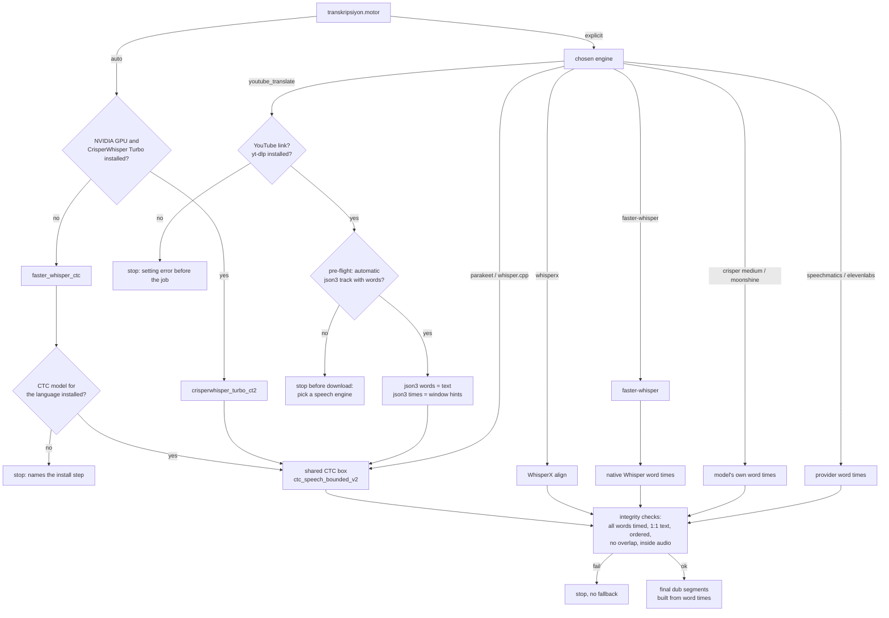

# Timing sources: where every word time comes from

Which component produces the start and end of each word, when each source is used, why, how they compare (only where
a measurement exists), and where CTC alignment is skipped. Türkçe: [../muhendislik/zaman_kaynaklari.md](../muhendislik/zaman_kaynaklari.md).

Evidence labels as in [README.md](README.md): **measured**, **documented**, **no record**. Code table (single source for
this page and its tests): `src/dublaj_hatti/bolum_20_transkripsiyon/zaman_kaynaklari.py`; tests:
`tests/test_zaman_kaynaklari.py`.

## 1. Short answer

- Word times drive everything downstream: final dub segments, TTS duration targets, video retiming and subtitles.
- The preferred source is **CTC forced alignment** (wav2vec2 via WhisperX 3.8.6, policy `ctc_speech_bounded_v2`):
  either the shared CTC box or WhisperX's own `align()`. See [word_alignment.md](word_alignment.md) and
  [ADR 0005](../adr/0005-ctc-forced-alignment-only-time-source.md).
- Five engines keep their **own** word times and never enter CTC: `faster-whisper` (explicit choice only), CrisperWhisper 2 Medium, Moonshine,
  Speechmatics, ElevenLabs Scribe v2 (§4).
- A **ready-made subtitle** (the YouTube automatic `json3` caption track) is used only as **text**; its times are only
  hints for the alignment windows and never become word times (§3).
- Times are never derived from segment boundaries. The direction is always words → segments (§6).
- No source falls back to another one silently. A missing or inconsistent timing stops the job with a message
  ([ADR 0009](../adr/0009-fail-closed-no-silent-fallback.md)).

## 2. Per engine (source side)

The engine is chosen by `[transkripsiyon] motor` (`auto` resolves in `yapilandirma.stt_secimi_coz`). Per-engine pages:
[../motorlar/](../motorlar/). How each language is detected: [../tarifler/dil_tespiti.md](../tarifler/dil_tespiti.md).
Which combinations are allowed: [../tarifler/kombinasyonlar.md](../tarifler/kombinasyonlar.md).

| Engine | Word times come from | What the engine gives the aligner | When it is selected |
|---|---|---|---|
| [crisperwhisper_turbo_ct2](../motorlar/crisperwhisper_turbo_ct2.md) | shared CTC box (native times kept for diagnostics only) | text + native-time windows | `auto` on an NVIDIA GPU when installed; or explicitly |
| [faster_whisper_ctc](../motorlar/faster_whisper_ctc.md) | shared CTC box (Whisper's own times kept for diagnostics only) | faster-whisper segments | `auto` without GPU or without CrisperWhisper Turbo; or explicitly (§2.1) |
| [faster-whisper](../motorlar/faster-whisper.md) | Whisper cross-attention timestamps (`word_timestamps=True`), **no CTC** | – | explicitly only |
| [whisperx](../motorlar/whisperx.md) | WhisperX `align()` (wav2vec2 CTC) inside its worker | ASR segments | explicitly; also the target of the distil / Parakeet language fallback |
| [parakeet_cpu_align](../motorlar/parakeet_cpu_align.md) | shared CTC box | token times; a gap ≥ 1.0 s starts a new window (80 ms pad) | explicitly (English, CPU) |
| [whisper_cpp_cpu_align](../motorlar/whisper_cpp_cpu_align.md) | shared CTC box | whisper.cpp segments | explicitly (English, CPU) |
| [youtube_translate](../motorlar/youtube_translate.md) | shared CTC box | json3 start hints grouped into windows | explicitly, YouTube link only (§3) |
| [crisperwhisper2_medium](../motorlar/crisperwhisper2_medium.md) | the model's own attention times, **no CTC** | – | explicitly |
| [moonshine_medium_streaming_en](../motorlar/moonshine_medium_streaming_en.md) | native streaming timestamps, **no CTC** (experimental) | – | explicitly (English) |
| [speechmatics](../motorlar/speechmatics.md) | provider API word times, **no CTC** | – | explicitly, your own key |
| [elevenlabs_scribe_v2](../motorlar/elevenlabs_scribe_v2.md) | provider API word times, **no CTC** | – | explicitly, your own key |

Code: the dispatcher is `transcribe_and_align()` in `src/dublaj_hatti/bolum_00_omurga/core/dubber.py`; the CTC box is
`src/dublaj_hatti/bolum_30_hizalama_ve_segment/ctc_kelime_hizalama/` (`run_ctc_word_alignment`).

### Decision flow

Priority, as code expresses it: there is no runtime ranking between sources. One engine is chosen per job and that
engine's source is used; nothing is mixed and nothing is swapped mid-job. The only automatic choices are `auto`
(above) and the documented language fallbacks (distil English-only models and Parakeet switch to WhisperX for a
non-English source; logged; see [transcription.md](transcription.md) §9).

### 2.1 `auto` fallback: faster-whisper text + CTC (`faster_whisper_ctc`)

- **Rule:** `auto` resolves to `crisperwhisper_turbo_ct2` on an NVIDIA GPU when it is installed, otherwise to
  `faster_whisper_ctc` (`yapilandirma.stt_secimi_coz`). An explicitly chosen `faster-whisper` keeps Whisper's own word
  times; nothing else changes for it. The split is selectable through the existing setting `transkripsiyon.motor`
  (`faster_whisper_ctc` can also be chosen explicitly); no extra key was added.
- **Binding:** the same as whisper.cpp and Parakeet: faster-whisper runs as before; its segments (text, start, end)
  become the CTC windows; `run_ctc_word_alignment` measures every word. Whisper's own word times are written only for
  diagnostics (`faster_whisper_ctc/whisper_dogal_kelimeler.json`); `faster_whisper_ctc/report.json` records the window
  count, both word counts and `text_identical` (Whisper splits `İstanbul'a` into two tokens, CTC keeps one word, so a
  lower count is not a text change).
- **Missing model, never a silent fallback:** with a fixed `kaynak_dil` the model is checked before the job starts
  (settings error); with `auto` language the missing pinned models are written as a reason at start and the job stops
  right after language detection, before alignment. The message names the step: `scripts/kur.ps1 -Adim modeller`
  (aligners only: `python scripts/modelleri_indir.py --adim hizalama`). Pinned: `en`, `tr`. Other languages need one
  deliberate run with `DUBLAJ_CEVRIMICI=1`. `dubla kontrol` prints `hizalama (CTC): en=…, tr=…` and a warning line.
  Code: `bolum_00_omurga/runtime/ctc_model_durumu.py`.
- **CPU cost (measured, one run each, `genel.cihaz = cpu`):** 23.8 s English: recognition ≈ 140 s, CTC 16.5 s
  (load 11 s, align 2.6 s, speech bounding 1.8 s). 60 s Turkish: recognition ≈ 161 s, CTC 42.9 s (load ≈ 10 s, align
  18.6 s, speech bounding 13.0 s). CTC adds ≈ 12–27 % to the CPU transcription time, so the CTC path stays the default
  on CPU; WhisperX (option 2) was not needed. Timeout: 1800 s on GPU; on CPU `max(1800, 600 + 3 × audio seconds)`
  (covers the worst documented CPU case, 3.5 min audio in ≈ 10 min).
- **Native vs CTC on the same runs (difference, not error against a reference):** word starts differ by 145 ms mean /
  102 ms median (English, 53 words) and 117 ms / 70 ms (Turkish, 93 matched words; max 1.38 s).

## 3. Ready-made YouTube captions (`youtube_translate`)

Code: `src/dublaj_hatti/bolum_20_transkripsiyon/youtube_json3_kaynagi/engine.py`. Optional extra `youtube`
(`pip install .[youtube]`). Use only content you own or are permitted to use; platform terms are the user's
responsibility (see [../../ETHICS.md](../../ETHICS.md)).

### 3.1 What is fetched, and how

| Item | Behaviour |
|---|---|
| Track type | **automatic captions only** (`automatic_captions` in yt-dlp metadata). Uploaded/manual subtitles (`subtitles`) are not read |
| Format | **`json3` only**. `vtt`, `srv1/2/3`, `ttml` and `srt` are never used as a fallback |
| Language order | 1) the video's language (`language`, else `original_language`; region dropped: `fr-FR` → `fr`), 2) `en`, 3) any other language alphabetically. With no language metadata the preferred language is `en` |
| yt-dlp calls | `YoutubeDL({"quiet": True, "no_warnings": True, "skip_download": True}).extract_info(url, download=False)` for metadata; the chosen track URL is read with `YoutubeDL({"quiet": True, "no_warnings": True}).urlopen(url)`. Only public, documented yt-dlp API; no other endpoint and no signature handling of our own |
| URL check | host must be `youtube.com` / `youtu.be` or a subdomain (`www.`, `m.`); look-alike hosts are rejected |
| Parser | per event `tStartMs`, per piece `tOffsetMs` → `start_hint` (seconds); HTML entities decoded; multi-word pieces split into words that share one hint; `[Music]`, `(laughs)`, `♪`, `♫` and empty pieces dropped; events without `tStartMs` ignored; words sorted by hint. **No `end` is produced** |
| Alignment windows | words grouped at sentence ends, gaps > 2.5 s, > 18 s span or 80 words; window = first hint − 0.25 s … next window's first hint (last one: audio end) |
| Times | from the shared CTC box only (`word_timing_source = ctc_kelime_hizalama`, `json3_timing_role = alignment_window_hint_only` in `report.json`) |
| Timeout | `max(120, 90 + audio_minutes × 8)` s; documented basis: successful alignment cost ≈ 2.8–3.1 s per audio minute |
| Leading pad | not applied (no speech recognition runs); a non-zero offset is an error |

### 3.2 When it is used and when it is not trusted

- Used only when the user selects `transkripsiyon.motor = "youtube_translate"` and the source is a YouTube link. It is
  never chosen by `auto`. A local file with this engine is a setting error.
- **Pre-flight (before download):** `probe_youtube_json3` runs at the start of `full_dub_pipeline` and
  `transcript_only_pipeline`. If no usable automatic json3 track exists, the job stops before download, audio extraction
  and separation, and names speech engines to pick instead. Skipped when resuming a job.
- **json3 times are never trusted as word times.** They are window hints only (caption cues are display timings, not
  word boundaries; documented).
- The aligned word list must match the json3 word list **1:1** (case and edge punctuation ignored); any mismatch or a
  word without times stops the job.
- After alignment, small negative durations and overlaps are repaired (midpoint split, minimum 10 ms). If any word
  moves by more than **0.3 s**, the job stops (`zaman duzeltmesi guvenli siniri asti`): the captions and the audio
  disagree (for example music or a different cut). Negative durations or overlaps left after repair also stop it.
- Debug folder per job: `youtube_json3_transkripsiyon_kaynagi/` (raw json3, clean words, alignment input, aligned
  words and segments, quality report, report).

Quality versus speech recognition: **no record** (no measurement of json3 + CTC against an ASR engine was kept).
Text accuracy equals the caption track's accuracy.

## 4. Engines that keep their own times (CTC skipped)

| Engine | Why CTC is not run | Measured comparison |
|---|---|---|
| faster-whisper (explicit only) | Kept as the fast path without an alignment step, and for languages without a CTC model. `auto` does not use it: its fallback is `faster_whisper_ctc` (§2.1) | On a 10-file English corpus (3.9 h), CTC-timed engines had word-start MAE 28–51 ms and 0 zero-length words; distil native timestamps 106–126 ms and 611–899 zero-length words ([transcription.md](transcription.md) §1). Non-distil faster-whisper native timing against CTC: **no record** |
| crisperwhisper2_medium | Runs in its own environment with `forced_alignment = false` and uses the model's own word times (documented). Why it was not moved to CTC like Turbo: **no record** | **no record**. Note: the same native-attention family produced 0 ms and 40 ms words on Turbo, which is why Turbo moved to CTC ([crisperwhisper_turbo_ct2.md](crisperwhisper_turbo_ct2.md) §6) |
| moonshine_medium_streaming_en | Experimental. Text errors also occur at chunk boundaries, so CTC re-alignment alone does not fix it; backwards starts stop the run (`MoonshineDeneyselHatasi`) and times are never edited | [transcription.md](transcription.md) §6 |
| speechmatics | Provider returns word times; no CTC pass in the code. Rationale for skipping CTC: **no record** | documented: against WhisperX + CTC, ≈ 100 ms mean difference, 75 % of words within 100 ms; 60 s video ≈ 6 s vs ≈ 40 s (sample size not recorded) |
| elevenlabs_scribe_v2 | Provider returns word times; no CTC pass. Rationale: **no record** | **no record** |

All five still pass the shared checks (§5) and the final segment builder.

## 5. Checks every source passes

- `check_word_overlaps` on the aligned data; `refine_segment_times_from_words` sets each recognised segment to its first
  word start and last word end.
- Final dub segments are always rebuilt from the flat word list (`nihai_dublaj_segmentlerini_olustur`): gap threshold
  1.0 s, at most 150 words, punctuation priority `. ? ! ,`. Engine segment boundaries are not reused.
- CTC box post-checks: every word timed, none dropped, order preserved, no over-long word, no absorbed silence,
  monotonic, no overlap, nothing beyond the audio end ([word_alignment.md](word_alignment.md) §3–4).
- Integrity failures stop the job; checkpoint fingerprints include the CTC boundary policy, so changing it invalidates
  older transcriptions on purpose.

## 6. Segment times vs word times

- **No code derives word times from segment times** (no proportional split by characters or duration). This was
  rejected as an estimate, not a measurement ([word_alignment.md](word_alignment.md) §2).
- Where an engine gives only segments (whisper.cpp, WhisperX ASR output) or only text (`hizala`, json3), the segments
  are used as **alignment windows** and CTC measures the words inside them.
- Words without times are dropped by the WhisperX worker and the CTC box worker; json3 and CrisperWhisper Turbo then
  stop on the 1:1 text check.
- `dubla hizala <audio> <text>` (stage command) aligns a known text: a `.txt` file is one window over the whole audio; a
  transcript JSON uses its segment times as windows. Local `.srt` / `.vtt` files are **not** accepted as a timing or
  text source (the earlier version of the pipeline had no such input either).

## 7. Generated side: subtitle times of the dub

- Source: the verified per-candidate word timeline mapped to the video timeline (Supertonic candidates); otherwise
  forced alignment of the final dub track (`audio_new_timeline.wav` + final segment texts). Missing alignment fails the
  job ([video_subtitles_and_resume.md](video_subtitles_and_resume.md) §4).
- The producer writes `subtitle_timing_contract.json` with the TTS engine name; the subtitle renderer reads it back and
  checks engine, language, timing source, method and word count.
- Every segment TTS engine (`supertonic`, `voxcpm2`, `xtts`) is a supported contract engine with its own debug folder
  (`<engine>_timing_debug/`). Earlier in this repository the contract only knew `supertonic`/`xtts` and the reader
  always expected `supertonic`, so burned-in subtitles failed for VoxCPM2 (unsupported engine) and XTTS (engine
  mismatch); fixed and covered by `tests/test_zaman_kaynaklari.py`.

## 8. Differences from the earlier version of the pipeline

| Item | Earlier version | This repository |
|---|---|---|
| json3 track choice, parser, windows, repair, 1:1 check, timeout | – | identical (compared function by function) |
| Pre-flight json3 check | GUI and chat-bot menus probed before queueing; the GUI then switched the engine to Parakeet | probe inside the pipeline (covers CLI, GUI, web, bot); stops with a message, no engine switch |
| YouTube URL check | substring match on the host | exact host or subdomain |
| CTC and `soundfile` imports in the json3 module | at import time | lazy (parser and track choice testable without numpy) |
| Turbo checkpoint fingerprint of the repair code | pointed at the json3 module (where the repair lived) | points at `ctc_kelime_hizalama/zaman_onarimi.py`, the copy Turbo actually runs; the json3 copy is kept and a test asserts both behave identically |
| All other engine timing paths | – | identical apart from package paths, hidden subprocess windows and the Moonshine chronology stop |

## 9. Open items

- Closed: `auto` without CrisperWhisper used faster-whisper native timestamps while ADR 0017 and the installation pages
  said "faster-whisper + CTC"; the code now follows the pages (`faster_whisper_ctc`, §2.1).
- CPU cost of the CTC step rests on one short run per language; long-audio CPU timing is not measured.
- No measurement of json3 + CTC, CrisperWhisper Medium attention times or ElevenLabs word times against CTC.
- VAD-window preparation for engines with no time evidence is a rule, never measured ([word_alignment.md](word_alignment.md) §8).
