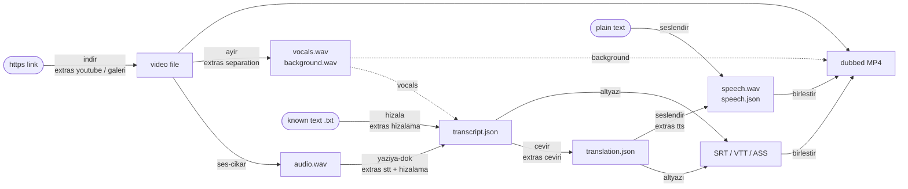
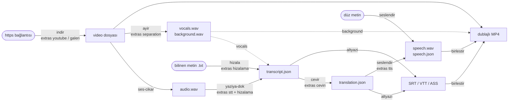

# Architecture: stages as building blocks

[Türkçe](#türkçe) · The pipeline is a chain of stages. Each stage is also a standalone tool: a CLI subcommand (`dubla <stage>`), a
function in `dublaj_hatti.api`, and a set of pip extras. Stages talk only through files with a fixed format, so you can
run one stage, replace one with your own tool, or build something else from the parts ([examples/](../examples/)).

Engineering details of each stage (why it works this way, measurements): [docs/engineering/](engineering/) and
the decision records in [docs/adr/](adr/).

## Stage map



`dubla <video>` (and `api.dubla`) runs the whole recommended flow in one job, adding what the single stages do not:
speaker separation and per-speaker voices, duration fitting (natural blocks, atempo), background mix, checkpoints and
resume, the job store. Single stages are the plain building blocks.
The full flow stage by stage, with the files between stages and the branches by setting:
[engineering/pipeline-flow.md](engineering/pipeline-flow.md).

## Design principles

Each part of the pipeline follows the same small set of rules. When a choice looks unusual, one of these is usually the
reason; the linked record gives the evidence and the rejected alternatives.

| # | Principle | What it means in practice | Record |
|---|---|---|---|
| 1 | One GPU job at a time, one process per heavy model | separation, recognition, alignment, diarization, gender and TTS each run in a subprocess that exits after its job; a resource lock (`gpu` capacity 1) serialises them; this is how every model fits a 4 GB card | [ADR 0001](adr/0001-one-gpu-job-and-process-per-model.md), [gpu_memory_and_isolation.md](engineering/gpu_memory_and_isolation.md) |
| 2 | Conflicting dependencies get their own environment | an engine that would change the main environment's pins runs from its own interpreter as a subprocess (CrisperWhisper Turbo in WSL2, CrisperWhisper Medium, Moonshine, VoxCPM2, XTTS optional, RVC); the main package never imports them | [gpu_memory_and_isolation.md](engineering/gpu_memory_and_isolation.md) §5, [ADR 0004](adr/0004-crisperwhisper-turbo-ct2-int8.md), [ADR 0015](adr/0015-tts-engine-set-and-default.md) |
| 3 | No silent fallback | a stage delivers its validated output or stops with a clear error; retries stay inside the same engine and are recorded | [ADR 0009](adr/0009-fail-closed-no-silent-fallback.md) |
| 4 | CTC forced alignment is the only source of word times | recognizer timestamps, caption times and TTS-internal boundaries are at most window hints; source and generated speech are both aligned | [ADR 0005](adr/0005-ctc-forced-alignment-only-time-source.md), [word_alignment.md](engineering/word_alignment.md) |
| 5 | Dub segments follow speech pauses | one segmenter for every recognizer: a gap > 1.0 s starts a segment, large segments split at punctuation up to 150 words | [ADR 0006](adr/0006-two-stage-dub-segmentation.md) |
| 6 | Meaning stays in its segment | the translation contract gives one natural candidate per segment ID and the model writes spoken forms of numbers; timing is advisory at this stage | [ADR 0007](adr/0007-natural-blocks-translation-contract.md) |
| 7 | Real synthesized duration decides timing | the measured length of the real audio drives candidate choice, optional `atempo` and video retiming; in-model TTS speed is fixed per voice | [ADR 0010](adr/0010-real-tts-duration-is-canonical.md), [tts_timing_and_mix.md](engineering/tts_timing_and_mix.md) |
| 8 | Engines are boxes with one result contract | every TTS engine returns per-segment audio measured by the same execution layer; voice conversion (RVC) is a separate post-TTS layer | [ADR 0015](adr/0015-tts-engine-set-and-default.md), [ADR 0016](adr/0016-rvc-as-post-tts-conversion.md) |
| 9 | Optional work runs only when needed | separation runs when a background is measured (`auto_background`) or requested; speaker separation, smart frame and cover images are opt-in | [ADR 0003](adr/0003-automatic-background-detection.md) |
| 10 | Every stage is resumable and fingerprinted | inputs, settings and a contract version decide whether a stage output can be reused | [ADR 0012](adr/0012-stage-checkpoints-and-resume.md) |
| 11 | Defaults are proven and redistributable | defaults reproduce the most-measured flow within permissive licences; non-commercial or conditional engines need an explicit acceptance; voice imitation needs consent | [ADR 0017](adr/0017-defaults-and-licence-gate.md), [ADR 0008](adr/0008-translation-backend-order.md) |
| 12 | Measure before changing | a change is accepted after an isolated experiment on the same input, one variable changed, outputs compared, and a second run through the real entry point | [engineering/README.md](engineering/README.md) |

## Stages

| Stage | CLI | Python | Extras | Input | Output | GPU |
|---|---|---|---|---|---|---|
| download | `dubla indir URL -o dir/` | `api.indir(url, dir)` | `youtube` or `galeri` | https link | video file | no |
| audio | `dubla ses-cikar v.mp4 -o a.wav` | `api.ses_cikar(v, wav)` | none (ffmpeg) | video / audio | WAV, 16 kHz mono default | no |
| separation | `dubla ayir v.mp4 -o dir/` | `api.ayir(v, dir)` | `separation` | video / audio | `vocals.wav`, `background.wav` | optional |
| speech-to-text | `dubla yaziya-dok v.mp4 -o t.json` | `api.yaziya_dok(v, json)` | `stt`, `hizalama` + `cpu`/`gpu` | video / audio | `transcript.json` + `.srt` | optional |
| word alignment | `dubla hizala a.wav t.txt --dil en` | `api.hizala(wav, txt, json)` | `hizalama` + `cpu`/`gpu` | audio + text / transcript | `transcript.json` with words | optional |
| translation | `dubla cevir t.json --hedef-dil tr` | `api.cevir(json, json)` | `ceviri` (+ CLI / key) | transcript | `translation.json` | optional |
| text to speech | `dubla seslendir IN -o dir/` | `api.seslendir(in, dir)` | `tts` (VoxCPM2: separate install) | text, .txt, transcript/translation | `speech.wav` (+ `speech.json`) | Supertonic optional, VoxCPM2 required |
| subtitles | `dubla altyazi t.json --kip karaoke` | `api.altyazi(json, out)` | none | transcript / translation / WhisperX JSON | SRT, VTT, ASS | no |
| mux | `dubla birlestir v.mp4 -o o.mp4 --ses s.wav` | `api.birlestir(v, out, ses=..)` | none (ffmpeg) | video + audio and/or subtitles | MP4 | no |
| full flow | `dubla v.mp4` | `api.dubla(v)` | `onerilen` + `cpu`/`gpu` | video / link | dubbed MP4 + all files | optional |

`dubla <stage> --help` lists every option. All stage commands accept the shared `--ayar section.key=value` and
`--ayarlar file.toml` (same keys as `varsayilan.toml`); `--json` prints the result as one JSON object.
Exit codes: `0` done, `1` the stage failed (engine, model, ffmpeg), `2` usage, setting or input error.

## Extras (install only what a stage needs)

| Extras | Packages (lower bounds in `pyproject.toml`) | For |
|---|---|---|
| *(none)* | standard library only | formats, subtitles, CLI shell, desktop and web interface |
| `cpu` / `gpu` | torch, torchaudio (index URL differs) | every model stage |
| `stt` | faster-whisper, ctranslate2, soundfile, numpy, huggingface-hub, python-dotenv, psutil, requests | yaziya-dok |
| `hizalama` | whisperx | hizala, word times in yaziya-dok |
| `ceviri` | transformers, sentencepiece, requests | cevir (offline Opus-MT; LLM backends use their own CLI / key) |
| `tts` | onnxruntime, onnx, soundfile, numpy, scipy, huggingface-hub, psutil | seslendir (Supertonic) |
| `konusmaci` | modelscope, scikit-learn, hdbscan, umap-learn, fastcluster, addict, simplejson, PyYAML, transformers | speaker separation + gender in the full flow |
| `video` | pillow | subtitle burn-in images of the full flow |
| `separation` | demucs | ayir, background preservation |
| `youtube` / `galeri` | yt-dlp (Unlicense; imported lazily, only for links) / gallery-dl (GPL-2.0; separate process, never imported) | indir, link input |
| `onerilen` | all stage extras above | the recommended flow (`dubla <video>`) |

The tested, hash-locked install is still `scripts/kur.ps1` (requirements/*.txt, then the package with `--no-deps`).
Models are never pip packages: `scripts/modelleri_indir.py` fetches them at pinned commits with SHA-256 checks.

## File formats

The JSON Schemas (draft 2020-12) live in [`src/dublaj_hatti/semalar/`](../src/dublaj_hatti/semalar/);
`dublaj_hatti.bicimler.dogrula()` checks the same rules with the standard library. Times are seconds (float, >= 0,
3 decimals). The segment/word layout is WhisperX-compatible, so a WhisperX JSON file is accepted wherever a
transcript is expected. Only file names, never directories, are written into these files.

### transcript.json (`dublaj-hatti/transcript@1`)

```json
{
  "schema": "dublaj-hatti/transcript@1",
  "language": "en",
  "engine": "faster-whisper",
  "source": "talk.mp4",
  "segments": [
    {"id": 1, "start": 0.5, "end": 2.0, "text": "Welcome to the workshop.", "speaker": "SPEAKER_00",
     "words": [{"word": "Welcome", "start": 0.5, "end": 0.9, "score": 0.98},
               {"word": "to", "start": 0.9, "end": 1.0}]}
  ]
}
```

Required: `schema`, `language` (ISO 639-1, `und` if unknown), `segments[].start/end/text`. Optional: `engine`,
`source`, `id`, `speaker`, `words` (needed for word and karaoke subtitles).

### translation.json (`dublaj-hatti/translation@1`)

Same shape; `language` is the target language, `source_language` is required and every segment keeps its original
text in `source_text`. Timing is copied from the transcript (translation never moves segments).

### speech.json (`dublaj-hatti/speech@1`)

```json
{
  "schema": "dublaj-hatti/speech@1",
  "engine": "supertonic", "voice": "F1", "language": "tr", "sample_rate": 44100,
  "audio": "speech.wav",
  "segments": [{"id": 1, "start": 0.5, "end": 2.0, "text": "Atölyeye hoş geldiniz.",
                "audio": "parcalar/00001.wav", "duration": 1.62}]
}
```

`audio` paths are relative to the JSON file. `speech.wav` is the timed track: each segment starts at its `start`.
The stage uses the same TTS settings (`ses.*`: voice, flow mode, atempo) as the full flow; a `duration` longer than
`end - start` shows where speech still overflows its slot.

### Subtitles

`dubla altyazi` / `api.altyazi`: `--bicim srt|vtt|ass` (default: output extension), `--kip segment` (one cue per
segment, at most two balanced lines of ~42 characters), `kelime` (one cue per word), `karaoke` (ASS `\k` tags or
WebVTT inline timestamps; silences between words are kept exact).

## Python API contract

* Everything in `dublaj_hatti.api.__all__` and `dublaj_hatti.bicimler.__all__` follows semantic versioning; schema
  ids carry their own version (`@1`) and change only with a new id.
* Names: the product and distribution are `DubWorld` / `dubworld`; the import package stays `dublaj_hatti`, the
  commands stay `dubla*` and schema ids stay `dublaj-hatti/...@1`, so code, saved files and resumable jobs keep working.
* Importing `dublaj_hatti.api` is cheap: torch and models load inside the stage that needs them.
* Settings: `with api.ayarlarla(dosya=None, ifadeler=["genel.cihaz=cpu"]): ...` applies a layer to every stage call
  in the block. Order: `varsayilan.toml` < user files < this layer < explicit stage arguments < the `ayarlar` dict.
* Errors: `AyarHatasi` (setting), `KaynakHatasi` (source), `BicimHatasi` (stage file), `AsamaHatasi` (stage failed).
* Outputs are written atomically (temporary file + rename); a stage's scratch folder is removed on success and kept
  next to the output on failure for diagnosis.

## Sources and links

Input is a local file or an https link. `dublaj_hatti.kaynak_girdisi` decides the link type and checks only the tool
that type needs: gallery sites need gallery-dl (extras `galeri`), video sites need yt-dlp (extras `youtube`); a
missing tool gives an install hint, never a stack trace. The CLI and the interface (link field; local paths are never accepted there) both use this one check. Only content you own or may
use (ETHICS.md).

---

## Türkçe

Hat bir aşamalar zinciridir. Her aşama aynı zamanda tek başına bir araçtır: bir CLI alt komutu (`dubla <stage>`),
`dublaj_hatti.api` içinde bir işlev ve bir pip ek kümesi. Aşamalar yalnız sabit biçimli dosyalarla konuşur; böylece
tek bir aşama çalıştırılabilir, bir aşamanın yerine kendi aracınız konabilir ya da parçalardan başka bir şey kurulabilir
([examples/](../examples/)).

Her aşamanın mühendislik ayrıntıları (neden böyle çalışır, ölçümler): [docs/engineering/](engineering/) ve
[docs/adr/](adr/) içindeki karar kayıtları; kararların Türkçe özetleri: [muhendislik/kararlar.md](muhendislik/kararlar.md).

### Aşama haritası



`dubla <video>` (ve `api.dubla`) önerilen akışın tamamını tek işte çalıştırır ve tek aşamaların yapmadıklarını ekler:
konuşmacı ayrımı ve konuşmacı başına ses, süreye sığdırma (doğal bloklar, atempo), arka plan karışımı, checkpoint ve
devam, iş deposu. Tek aşamalar düz yapı taşlarıdır.
Tam akış aşama aşama, aşamalar arasındaki dosyalar ve ayara göre dallanmalarla:
[muhendislik/hat_akisi.md](muhendislik/hat_akisi.md).

### Tasarım ilkeleri

Hattın her parçası aynı küçük kural kümesine uyar. Bir seçim alışılmadık görünüyorsa nedeni genellikle bunlardan
biridir; bağlantılı kayıt kanıtı ve reddedilen seçenekleri verir.

| # | İlke | Uygulamada anlamı | Kayıt |
|---|---|---|---|
| 1 | Aynı anda tek GPU işi, her ağır model için bir süreç | ayrıştırma, tanıma, hizalama, konuşmacı ayrımı, cinsiyet ve TTS her biri işi bitince çıkan bir alt süreçte çalışır; bir kaynak kilidi (`gpu` kapasitesi 1) bunları sıraya koyar; her model 4 GB'lık karta böyle sığar | [ADR 0001](adr/0001-one-gpu-job-and-process-per-model.md), [gpu_memory_and_isolation.md](engineering/gpu_memory_and_isolation.md) |
| 2 | Çakışan bağımlılıklar kendi ortamını alır | ana ortamın sabit sürümlerini değiştirecek bir motor kendi yorumlayıcısından alt süreç olarak çalışır (WSL2'de CrisperWhisper Turbo, CrisperWhisper Medium, Moonshine, VoxCPM2, isteğe bağlı XTTS, RVC); ana paket bunları asla içe aktarmaz | [gpu_memory_and_isolation.md](engineering/gpu_memory_and_isolation.md) §5, [ADR 0004](adr/0004-crisperwhisper-turbo-ct2-int8.md), [ADR 0015](adr/0015-tts-engine-set-and-default.md) |
| 3 | Sessiz yedeğe geçiş yok | bir aşama doğrulanmış çıktısını verir ya da açık bir hatayla durur; yeniden denemeler aynı motor içinde kalır ve kaydedilir | [ADR 0009](adr/0009-fail-closed-no-silent-fallback.md) |
| 4 | Kelime zamanlarının tek kaynağı CTC zorlamalı hizalamadır | tanıyıcı zaman damgaları, altyazı zamanları ve TTS içi sınırlar en çok pencere ipucudur; hem kaynak hem üretilen konuşma hizalanır | [ADR 0005](adr/0005-ctc-forced-alignment-only-time-source.md), [word_alignment.md](engineering/word_alignment.md) |
| 5 | Dublaj segmentleri konuşma duraklamalarını izler | her tanıyıcı için tek segmentleyici: 1.0 s'den uzun boşluk yeni segment başlatır, büyük segmentler noktalamadan en çok 150 kelimeye kadar bölünür | [ADR 0006](adr/0006-two-stage-dub-segmentation.md) |
| 6 | Anlam kendi segmentinde kalır | çeviri sözleşmesi segment kimliği başına tek doğal aday verir ve model sayıların okunuş biçimini yazar; bu aşamada zamanlama yalnız öneridir | [ADR 0007](adr/0007-natural-blocks-translation-contract.md) |
| 7 | Zamanlamayı gerçek sentez süresi belirler | gerçek sesin ölçülen uzunluğu aday seçimini, isteğe bağlı `atempo`'yu ve videonun yeniden zamanlanmasını yönetir; model içi TTS hızı ses başına sabittir | [ADR 0010](adr/0010-real-tts-duration-is-canonical.md), [tts_timing_and_mix.md](engineering/tts_timing_and_mix.md) |
| 8 | Motorlar tek sonuç sözleşmeli kutulardır | her TTS motoru, aynı yürütme katmanının ölçtüğü segment başına ses döndürür; ses dönüştürme (RVC) TTS sonrası ayrı bir katmandır | [ADR 0015](adr/0015-tts-engine-set-and-default.md), [ADR 0016](adr/0016-rvc-as-post-tts-conversion.md) |
| 9 | İsteğe bağlı iş yalnız gerektiğinde çalışır | ayrıştırma, arka plan ölçüldüğünde (`auto_background`) ya da istendiğinde çalışır; konuşmacı ayrımı, akıllı kare ve kapak görselleri isteğe bağlıdır | [ADR 0003](adr/0003-automatic-background-detection.md) |
| 10 | Her aşama devam ettirilebilir ve parmak izlidir | girdiler, ayarlar ve bir sözleşme sürümü, bir aşama çıktısının yeniden kullanılıp kullanılamayacağına karar verir | [ADR 0012](adr/0012-stage-checkpoints-and-resume.md) |
| 11 | Varsayılanlar kanıtlanmış ve yeniden dağıtılabilirdir | varsayılanlar en çok ölçülmüş akışı serbest lisanslar içinde yeniden üretir; ticari olmayan ya da koşullu motorlar açık kabul ister; ses taklidi rıza ister | [ADR 0017](adr/0017-defaults-and-licence-gate.md), [ADR 0008](adr/0008-translation-backend-order.md) |
| 12 | Değiştirmeden önce ölç | bir değişiklik; aynı girdide yalıtılmış bir deneyden, tek değişken değiştirilip çıktılar karşılaştırıldıktan ve gerçek giriş noktasından ikinci bir koşudan sonra kabul edilir | [engineering/README.md](engineering/README.md) |

### Aşamalar

| Aşama | CLI | Python | Ekler | Girdi | Çıktı | GPU |
|---|---|---|---|---|---|---|
| indirme | `dubla indir URL -o dir/` | `api.indir(url, dir)` | `youtube` ya da `galeri` | https bağlantısı | video dosyası | hayır |
| ses | `dubla ses-cikar v.mp4 -o a.wav` | `api.ses_cikar(v, wav)` | yok (ffmpeg) | video / ses | WAV, varsayılan 16 kHz mono | hayır |
| ayrıştırma | `dubla ayir v.mp4 -o dir/` | `api.ayir(v, dir)` | `separation` | video / ses | `vocals.wav`, `background.wav` | isteğe bağlı |
| konuşmadan metne | `dubla yaziya-dok v.mp4 -o t.json` | `api.yaziya_dok(v, json)` | `stt`, `hizalama` + `cpu`/`gpu` | video / ses | `transcript.json` + `.srt` | isteğe bağlı |
| kelime hizalama | `dubla hizala a.wav t.txt --dil en` | `api.hizala(wav, txt, json)` | `hizalama` + `cpu`/`gpu` | ses + metin / transkript | kelimeli `transcript.json` | isteğe bağlı |
| çeviri | `dubla cevir t.json --hedef-dil tr` | `api.cevir(json, json)` | `ceviri` (+ CLI / anahtar) | transkript | `translation.json` | isteğe bağlı |
| metinden konuşmaya | `dubla seslendir IN -o dir/` | `api.seslendir(in, dir)` | `tts` (VoxCPM2: ayrı kurulum) | metin, .txt, transkript/çeviri | `speech.wav` (+ `speech.json`) | Supertonic isteğe bağlı, VoxCPM2 zorunlu |
| altyazı | `dubla altyazi t.json --kip karaoke` | `api.altyazi(json, out)` | yok | transkript / çeviri / WhisperX JSON | SRT, VTT, ASS | hayır |
| birleştirme | `dubla birlestir v.mp4 -o o.mp4 --ses s.wav` | `api.birlestir(v, out, ses=..)` | yok (ffmpeg) | video + ses ve/veya altyazı | MP4 | hayır |
| tam akış | `dubla v.mp4` | `api.dubla(v)` | `onerilen` + `cpu`/`gpu` | video / bağlantı | dublajlı MP4 + bütün dosyalar | isteğe bağlı |

`dubla <stage> --help` her seçeneği listeler. Bütün aşama komutları ortak `--ayar section.key=value` ve
`--ayarlar file.toml` seçeneklerini kabul eder (`varsayilan.toml` ile aynı anahtarlar); `--json` sonucu tek bir JSON
nesnesi olarak yazar. Çıkış kodları: `0` bitti, `1` aşama başarısız (motor, model, ffmpeg), `2` kullanım, ayar ya da
girdi hatası.

### Ekler (yalnız bir aşamanın gerektirdiğini kurun)

| Ekler | Paketler (alt sınırlar `pyproject.toml` içinde) | Ne için |
|---|---|---|
| *(yok)* | yalnız standart kütüphane | biçimler, altyazılar, CLI kabuğu, masaüstü ve web arayüzü |
| `cpu` / `gpu` | torch, torchaudio (index URL farklı) | her model aşaması |
| `stt` | faster-whisper, ctranslate2, soundfile, numpy, huggingface-hub, python-dotenv, psutil, requests | yaziya-dok |
| `hizalama` | whisperx | hizala, yaziya-dok içinde kelime zamanları |
| `ceviri` | transformers, sentencepiece, requests | cevir (çevrimdışı Opus-MT; LLM arka uçları kendi CLI / anahtarını kullanır) |
| `tts` | onnxruntime, onnx, soundfile, numpy, scipy, huggingface-hub, psutil | seslendir (Supertonic) |
| `konusmaci` | modelscope, scikit-learn, hdbscan, umap-learn, fastcluster, addict, simplejson, PyYAML, transformers | tam akışta konuşmacı ayrımı + cinsiyet |
| `video` | pillow | tam akışın altyazı yakma görüntüleri |
| `separation` | demucs | ayir, arka planı koruma |
| `youtube` / `galeri` | yt-dlp (Unlicense; tembel içe aktarılır, yalnız bağlantılar için) / gallery-dl (GPL-2.0; ayrı süreç, asla içe aktarılmaz) | indir, bağlantı girdisi |
| `onerilen` | yukarıdaki bütün aşama ekleri | önerilen akış (`dubla <video>`) |

Denenmiş, özetle kilitlenmiş kurulum yine `scripts/kur.ps1`'dir (önce requirements/*.txt, sonra `--no-deps` ile
paket). Modeller asla pip paketi değildir: `scripts/modelleri_indir.py` onları SHA-256 denetimiyle sabit commit'lerden
indirir.

### Dosya biçimleri

JSON Şemaları (draft 2020-12) [`src/dublaj_hatti/semalar/`](../src/dublaj_hatti/semalar/) içindedir;
`dublaj_hatti.bicimler.dogrula()` aynı kuralları standart kütüphaneyle denetler. Zamanlar saniyedir (float, >= 0,
3 ondalık). Segment/kelime düzeni WhisperX uyumludur; bu yüzden transkript beklenen her yerde bir WhisperX JSON
dosyası kabul edilir. Bu dosyalara yalnız dosya adları yazılır, asla klasörler yazılmaz.

#### transcript.json (`dublaj-hatti/transcript@1`)

```json
{
  "schema": "dublaj-hatti/transcript@1",
  "language": "en",
  "engine": "faster-whisper",
  "source": "talk.mp4",
  "segments": [
    {"id": 1, "start": 0.5, "end": 2.0, "text": "Welcome to the workshop.", "speaker": "SPEAKER_00",
     "words": [{"word": "Welcome", "start": 0.5, "end": 0.9, "score": 0.98},
               {"word": "to", "start": 0.9, "end": 1.0}]}
  ]
}
```

Zorunlu: `schema`, `language` (ISO 639-1, bilinmiyorsa `und`), `segments[].start/end/text`. İsteğe bağlı: `engine`,
`source`, `id`, `speaker`, `words` (kelime ve karaoke altyazıları için gerekir).

#### translation.json (`dublaj-hatti/translation@1`)

Aynı yapı; `language` hedef dildir, `source_language` zorunludur ve her segment özgün metnini `source_text` içinde
tutar. Zamanlama transkriptten kopyalanır (çeviri segmentleri asla kaydırmaz).

#### speech.json (`dublaj-hatti/speech@1`)

```json
{
  "schema": "dublaj-hatti/speech@1",
  "engine": "supertonic", "voice": "F1", "language": "tr", "sample_rate": 44100,
  "audio": "speech.wav",
  "segments": [{"id": 1, "start": 0.5, "end": 2.0, "text": "Atölyeye hoş geldiniz.",
                "audio": "parcalar/00001.wav", "duration": 1.62}]
}
```

`audio` yolları JSON dosyasına görelidir. `speech.wav` zamanlanmış izdir: her segment kendi `start` anında başlar.
Aşama, tam akışla aynı TTS ayarlarını (`ses.*`: ses, akış kipi, atempo) kullanır; `end - start`'tan uzun bir
`duration`, konuşmanın hâlâ yuvasından taştığı yeri gösterir.

#### Altyazılar

`dubla altyazi` / `api.altyazi`: `--bicim srt|vtt|ass` (varsayılan: çıktı uzantısı), `--kip segment` (segment başına
bir ipucu, ~42 karakterlik en çok iki dengeli satır), `kelime` (kelime başına bir ipucu), `karaoke` (ASS `\k`
etiketleri ya da WebVTT satır içi zaman damgaları; kelimeler arasındaki sessizlikler tam korunur).

### Python API sözleşmesi

* `dublaj_hatti.api.__all__` ve `dublaj_hatti.bicimler.__all__` içindeki her şey anlamsal sürümlemeye uyar; şema
  kimlikleri kendi sürümlerini taşır (`@1`) ve yalnız yeni bir kimlikle değişir.
* Adlar: ürün ve dağıtım adı `DubWorld` / `dubworld`; içe aktarma paketi `dublaj_hatti`, komutlar `dubla*` ve şema
  kimlikleri `dublaj-hatti/...@1` olarak kalır; böylece kod, kayıtlı dosyalar ve devam ettirilebilir işler bozulmaz.
* `dublaj_hatti.api`'yi içe aktarmak ucuzdur: torch ve modeller yalnız onlara ihtiyaç duyan aşamanın içinde yüklenir.
* Ayarlar: `with api.ayarlarla(dosya=None, ifadeler=["genel.cihaz=cpu"]): ...` bloktaki her aşama çağrısına bir
  katman uygular. Sıra: `varsayilan.toml` < kullanıcı dosyaları < bu katman < açık aşama argümanları < `ayarlar`
  sözlüğü.
* Hatalar: `AyarHatasi` (ayar), `KaynakHatasi` (kaynak), `BicimHatasi` (aşama dosyası), `AsamaHatasi` (aşama başarısız).
* Çıktılar atomik yazılır (geçici dosya + yeniden adlandırma); bir aşamanın çalışma klasörü başarıda silinir,
  başarısızlıkta tanı için çıktının yanında bırakılır.

### Kaynaklar ve bağlantılar

Girdi yerel bir dosya ya da bir https bağlantısıdır. `dublaj_hatti.kaynak_girdisi` bağlantı türüne karar verir ve
yalnız o türün gerektirdiği aracı denetler: galeri siteleri gallery-dl (extras `galeri`), video siteleri yt-dlp
(extras `youtube`) ister; eksik araç yığın izi değil, kurulum ipucu verir. CLI ve arayüz (bağlantı alanı; orada yerel yollar asla kabul edilmez)
bu tek denetimi kullanır. Yalnız sahibi
olduğunuz ya da kullanma hakkınız olan içerik (ETHICS.md).
