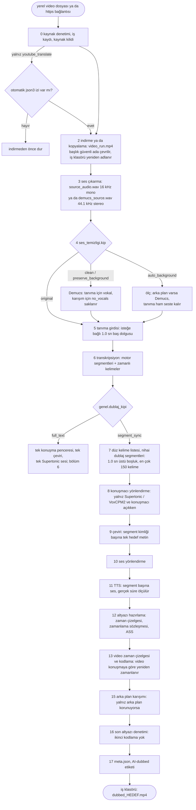

# Uçtan uca hat akışı: bağlantıdan ya da yerel dosyadan teslim edilen dublaja

Bir dublaj işini 0. adımdan (bir bağlantı ya da yerel video dosyası) dublajlı videonun iş klasörüne konduğu ana kadar
izleyen tek sayfa: her aşama, okuduğu dosya, yazdığı dosya, aradaki değişiklik, yolu hangi ayarın değiştirdiği ve
transkriptin neden kelime zamanlarına bölünüp yeniden gruplandığı. English: [../engineering/pipeline-flow.md](../engineering/pipeline-flow.md).

Bu sayfa omurgadır; derinlik aşama sayfalarındadır ve kopyalanmaz, bağlanır: [mimari](../mimari.md),
[zaman kaynakları](zaman_kaynaklari.md), [sabit değerler](sabit_degerler.md), [konuşmacı ve segmentler](konusmaci_ve_segmentler.md),
[çeviri](ceviri.md), [TTS zamanlama ve karışım](tts_zamanlama_ve_karisim.md),
[video, altyazı ve devam](video_altyazi_ve_devam.md), [motor sayfaları](../motorlar/), [kararlar](kararlar.md).

Kanıt etiketleri [README.md](README.md) ile aynı: **ölçüldü**, **belgelendi**, **kayıt yok**. Kod göndermeleri
`src/dublaj_hatti/`'ye göreli `dosya:satır` biçimindedir; `dubber.py`, `bolum_00_omurga/core/dubber.py` demektir. Satır
numaraları bu sayfa yazılırken alındı ve kayabilir; işlev adları geçerli kalır.

## 1. Harita

Varsayılan iş, `genel.dublaj_kipi = "segment_sync"` (segment eşleme) ile `dubla <video>`'dur. Numaralar
`bolum_00_omurga/core/asama_sozlesmesi.py` içindeki ara kayıt (checkpoint) sırasıdır (aşama kütüğü; 14 numarası kullanılmaz).

## 2. Adım 0: giriş, iş ve iş klasörü

| Konu | Davranış | Kod |
|---|---|---|
| Kabul edilen kaynak | `.mp4 .mkv .mov .webm .avi .m4v` uzantılı yerel dosya ya da `https` bağlantısı; video sitesi bağlantısı yt-dlp (ek `youtube`), galeri bağlantısı gallery-dl (ek `galeri`) ister; eksik araç yığın izi (stack trace) değil, kurulum ipucu verir | `kaynak_girdisi.py:42` |
| Giriş noktaları | CLI, masaüstü ve web arayüzü işi iş deposuna ekler ve tek bir çalıştırıcıdan geçirir; Python API iş deposu olmadan hattı doğrudan çağırır | `is_yonetimi/calistirici.py:86`, `api.py:563` |
| Hattan önceki kapılar | ayar doğrulama ve birleşim kuralları ([kombinasyonlar](../tarifler/kombinasyonlar.md)), lisans kapısı, sonra kaynak kilidi: CUDA'da `gpu`, değilse `cpu_agir` | `is_yonetimi/calistirici.py:92-126` |
| json3 ön denetimi | yalnız `transkripsiyon.motor = "youtube_translate"` ile: otomatik altyazı izi hiçbir şey indirilmeden önce yoklanır; devamda atlanır | `dubber.py:4679`, `dubber.py:183` |
| Çıktı kökü | proje kökünde `cikti/`; `genel.cikti_klasoru` (`--cikti`) ya da `DUBLAJ_OUTPUT_DIR` ortam değişkeniyle değişir; iş deposu `<kök>/_is_deposu/` içindedir | `bolum_00_omurga/runtime/output_paths.py:9-45`, `is_yonetimi/depo.py:95` |
| İş klasörü | `run_<YYYYmmdd_HHMMSS>` olarak açılır; 2. aşamadan sonra `<güvenli başlık, en çok 50 karakter>_<aynı zaman damgası>` olarak yeniden adlanır | `dubber.py:2015`, `dubber.py:4732-4760` |
| Devam | iş klasöründe zaten `pipeline_state.json` varsa çalıştırıcı onu `resume_run_dir` olarak verir; klasör çıktı kökünün altında olmalıdır | `is_yonetimi/calistirici.py:129-131`, `dubber.py:4678-4691` |

## 3. Aşama tablosu (segment eşleme, varsayılan)

Her aşama sonucunu iş klasörüne yazar ve `pipeline_state.json` içine girdi parmak izi ve sözleşme sürümüyle kaydeder
([ADR 0012](kararlar.md#0012)); aşağıdaki "s" o sözleşme sürümüdür.

| # | Aşama kimliği (s) | Girdi | İş klasöründeki çıktı | Ne değişir | Kod |
|---|---|---|---|---|---|
| 2 | `video_indirme_veya_kopyalama` (1) | bağlantı ya da yerel yol | `video_run.mp4` (sabit ad; baytlar kopyalanır, kap değişmez) | bağlantı: yt-dlp ≤ 1080p seçer, önce H.264, oynatma listesi yok, 4 GiB sınırı, zaman aşımı/403'te bir yeniden deneme; galeri: ayrı süreçte gallery-dl; yerel: kopya. Ayrıca toplanır: başlık ve yalnız bağlantılarda platform dili | `bolum_10_kaynak_edinme/adim_20_kaynak_alma/source_video.py:12`, `youtube_downloader.py:61-98` |
| 2a | (ara kayıt yok) dosya adı güvenliği ve video bilgisi | başlık | iş klasörü adı | NFKC, emoji silinir, harfler ASCII'ye çevrilir, küçük harf, Windows'un ayrılmış adları korunur, ≤ 50 karakter; ffprobe bilgisi yalnız günlüğe yazılır | `adim_10_dosya_adi_guvenligi/filename_sanitizer.py:111`, `dubber.py:4792` |
| 3 | `kaynak_ses_cikarma` (1) | `video_run.mp4` | `source_audio.wav` (16 kHz mono) ya da `demucs_source.wav` (Demucs bilerek çalışıyorsa 44.1 kHz stereo) | kap → PCM; ters fazlı stereo, mono indirgemeden önce onarılır | `dubber.py:1017-1029`, `adim_40_ses_cikarma/audio_extractor.py:60` |
| 4 | `demucs_vokal_ayirma` (2) | 3. aşamanın WAV dosyası | `demucs/htdemucs/demucs_source/vocals.wav`, `no_vocals.wav`, `clean_source.wav`, `asr_ready.wav`; `auto_background` ile ayrıca `arka_plan_olcumu.json` | konuşmayı arka plandan ayırır; tanımaya hangi dosyanın gittiği `ses_temizligi.kip`'e bağlıdır (bölüm 5) | `dubber.py:4817-4871`, `dubber.py:1042-1115` |
| 5 | `asr_sesi_hazirlama` (1) | tanıma girdisi | `asr_leading_pad.wav` ya da aynı dosya | `ASR_LEADING_PAD_ENGINES` listesindeki motorlar için başa 1.0 sn sessizlik; süre denetlenir (± 0.05 sn) ve tanımadan sonra her zaman 1.0 sn geri kaydırılır | `dubber.py:140-156`, `dubber.py:901-1006` |
| 6 | `transkripsiyon` (1) | 5. aşama sesi | `pipeline_transcription_result.json` (`segments`, `source_lang`, `alignment`) + motor kanıtları (`<motor>_HAM_segmentleri.txt`, CTC ve profil raporları) | ses → motor segmentleri ve zamanlı kelimeler; zamanlar motorun zaman kaynağından ([zaman_kaynaklari.md](zaman_kaynaklari.md)); dil sırası: platform üst verisi > `transkripsiyon.kaynak_dil` > otomatik algılama ([dil_tespiti.md](../tarifler/dil_tespiti.md)); motorun bildirdiği dil buradan sonra kullanılır | `dubber.py:4897-4978`, `dubber.py:3081` |
| 7 | `forced_alignment_ve_nihai_segmentler` (1) | 6. aşama sonucu | `pipeline_final_segments_result.json` | motor segmentleri bırakılır; düz kelime listesi dublaj segmentlerine yeniden gruplanır (bölüm 4) | `dubber.py:4980-5023`, `bolum_30_hizalama_ve_segment/nihai_dublaj_segmentleri.py:250` |
| 7a | (ara kayıt yok) kaynak tarafı metinler | nihai segmentler | `nihai_kaynak_dublaj_segmentleri.txt`, `transcript_<kaynak>.txt`, `full_paragraf_<kaynak>.txt`, `transcript_word_level.txt`, kaynak altyazı HTML önizlemesi | inceleme için okunur kopyalar; genel kelime çakışma denetimi burada çalışır | `dubber.py:5099-5122` |
| 8 | `konusmaci_yonlendirme` (2) | nihai segmentler + 4. aşamanın tanıma sesi | `pipeline_speaker_routing_result.json`, `supertonic_tts/konusmaci_secimi/` (`speaker_timeline.json`, `speaker_segment_split_report.json`, `speaker_voice_map.json`, …) | yalnız `ses.motor = "supertonic"` ve konuşmacı açıkken: 3D-Speaker, bir segment içindeki konuşmacı değişiminden bölünür, segmentler yeniden numaralanır, her konuşmacı bir ses alır; değilse atlanır | `dubber.py:5055-5098`, `bolum_50_seslendirme/supertonic_tts/konusmaci_secimi/router.py:82-160` |
| 9 | `ceviri` (2) | segmentler (kaynak metin) | `pipeline_translation_result.json` | metin, segment kimliği başına hedef metinle değişir; zamanlara dokunulmaz; kaynak metin `original_source_text` olarak saklanır; sayı uyuşmazlığı işi durdurur | `dubber.py:5136-5210` |
| 10 | `ses_yonlendirme` (2) | çevrilmiş segmentler | `pipeline_voice_routing_result.json`, `full_paragraf_<hedef>.txt`, `translated_segments_<hedef>.txt` | Supertonic: segment başına ses ve sabit hız; diğer motorlar: yalnız kayıt | `dubber.py:5211-5267` |
| 11 | `tts_ve_segment_sesleri` (2) | sesi yönlendirilmiş segmentler | `pipeline_tts_result/manifest.json`, `mixed_audio.wav`, `segment_audios/segment_<n>.wav`, ardından `dubbed_<hedef>.wav` | metin → segment başına ses; gerçek süre ölçülür; isteğe bağlı atempo (hız filtresi); üretilen konuşma altyazı zamanları için hizalanır | `dubber.py:5269-5332`, `dubber.py:1288` |
| 12 | `altyazi_hazirlama` (1) | TTS manifestosu + video | `pipeline_subtitle_result.json`, `subtitle_timing_contract.json`, `burnin_<kip>_<dil>.ass`, `audio_new_timeline.wav` | `altyazi.mod` ≠ `none` iken: yeni zaman çizelgesi erken hesaplanır ki altyazı tek kodlamada yakılabilsin; isteğe bağlı akıllı kare görsel videoyu üretir | `dubber.py:5333-5399`, `dubber.py:499` |
| 13 | `video_timeline_ve_final_mux` (2) | video + segment sesleri + zamanlama | `dubbed_<hedef>_base_mux.mp4`, `audio_new_timeline.wav`, `pipeline_video_mux_result.json`, `video_segments.json` | segment başına `video_speed = özgün / TTS süresi`; boşluklar 1.0 hızda korunur; segment başlangıç/bitişi yeni çizelgeyle değişir; altyazıyla tek kodlama (CQ ya da `max_mb`) | `dubber.py:5401-5503`, `bolum_60_video_ve_encode/timeline_ve_final_encode/video_processor.py:190-337` |
| 15 | `arka_plan_miksi` (2) | `no_vocals.wav` + zaman çizelgesi | `dubbed_<hedef>_background_stage.mp4`, `pipeline_background_result.json` | yalnız arka plan korunuyorsa: arka plan videoyla aynı kesim ve hızları alır, sonra dublajın altına `amix`; değilse atlanır | `dubber.py:5509-5571`, `dubber.py:1733` |
| 16 | `final_altyazi_yakma` (1) | 12. aşama sonucu | `dubbed_<hedef>.mp4`, `pipeline_final_subtitle_result.json` | altyazının tek kodlamaya girdiğini denetler; ikinci kodlama yasaktır ve işi durdurur | `dubber.py:5572-5626` |
| 17 | `final_dogrulama_ve_meta` (1) | son video | `meta.json`; video AI-dubbed kap üst verisini alır | seçimlerin ve sürelerin özeti; iş deposu işi `run_dir` ve `dubbed_video` ile `completed` işaretler | `dubber.py:5628-5730`, `bolum_60_video_ve_encode/timeline_ve_final_encode/yapay_zeka_etiketi.py:20`, `is_yonetimi/calistirici.py:150-153` |

Teslim edilen sonuç: `<çıktı kökü>/<başlık>_<zaman damgası>/dubbed_<hedef>.mp4` ve yanında `meta.json`. Çalışma kopyaları
(`*_working.mp4`, `*_base_mux.mp4`, `*_background_stage.mp4`) ara kayıt eserleri olarak klasörde kalır.

## 4. Bir aşamanın çıktısı ile sonrakinin girdisi arasında ne değişir

| Nereden → nereye | Kural | Kod |
|---|---|---|
| motor sonucu → düz kelime listesi | motor segment sınırları bırakılır; kelimeler sırayla art arda eklenir; hiçbir şey yeniden zamanlanmaz | `dubber.py:1279` |
| kelime listesi → ana segmentler | `sonraki.başlangıç − önceki.bitiş > 1.0 sn` olunca yeni ana segment başlar; ana segmentler asla birleştirilmez | `nihai_dublaj_segmentleri.py:74` |
| ana segment → nihai segmentler | ≤ 150 kelime: kalır; ≥ 151 kelime: önce `.` sonra `?` sonra `!` sonra `,` noktasından, açgözlü biçimde 150'ye kadar bölünür; son çare 150'de sert kesim | `nihai_dublaj_segmentleri.py:166-196` |
| kelimeler → segment metni | metin kelimelerden yeniden kurulur: kelimeler arasında boşluk, boşluksuz yazılan bir dilin (`ja`, `zh`, `yue`, `th`, `lo`, `my`) art arda iki kelimesi arasında boşluk yok; motorun kendi segment metni yeniden kullanılmaz | `nihai_dublaj_segmentleri.py:208` |
| kelimeler → segment zamanları | başlangıç = ilk kelimenin başı, bitiş = son kelimenin sonu; konuşmacı = yalnız her kelimede aynıysa o konuşmacı, değilse boş | `nihai_dublaj_segmentleri.py:199-231` |
| bütünlük | çıktı kelimeleri girdi kelimelerine eşit olmalı (kayıp, tekrar ya da sıra değişimi yok) ve her segment ≤ 150 kelime olmalı, yoksa iş durur | `nihai_dublaj_segmentleri.py:234` |
| segment → konuşmacı parçaları (Supertonic, konuşmacı açık) | her kelime, zamanca en çok örtüştüğü konuşmacıya gider; 0.40 sn'den kısa gruplar komşuya katılır; parçalar ana segmentlerinden çıkmaz; yeniden numaralanır | `supertonic_tts/konusmaci_secimi/router.py:27`, `router.py:160` |
| kaynak metin → hedef metin | segment kimliği başına tek aday; segmentler komşu bağlamla gruplar hâlinde gönderilir; zamanlar kaynaktan kopyalanır | `dubber.py:5174-5191` |
| hedef metin → segment sesi | hedef, özgün yuvadır (`end − start`); kullanılan tek süre ölçülmüş işlenmiş süredir | [tts_zamanlama_ve_karisim.md](tts_zamanlama_ve_karisim.md) §1 |
| yuva + ses → yeni zaman çizelgesi | `speed_factor = TTS / özgün`; video hızı `1 / speed_factor`; segmentler arası boşluklar 1.0 hızda kendi öğeleri olur, duraklamalar korunur | `video_processor.py:190-337` |
| yeni çizelge → segment zamanları | 13. aşamadan sonra segment başlangıç/bitişi yeni çizelge değerleridir (`video_segments.json`); dürüst yeniden oynatmalar özgün sınırları saklanan özgün değerlerden kurar | `dubber.py:5446-5477`, [video_altyazi_ve_devam.md](video_altyazi_ve_devam.md) §5 |

## 5. Dallanmalar: bir seçim neyi değiştirir

| Ayar / seçim | Değer | Akışta ne değişir |
|---|---|---|
| iş türü | `dubla <video>` | 2–17. aşamalar |
| iş türü | `dubla transkript` | yalnız 2–6. aşamalar, ara kayıt yok; nihai segmentler transkripsiyonun içinde kurulur; çıktı `transcript_<kaynak>.srt` / `transcript_plain_<kaynak>.txt` / zaman damgalı / paragraf (`dubber.py:5754`) |
| kaynak | yerel dosya | 2. aşama kopyalar; platform dili yok |
| kaynak | video sitesi bağlantısı | yt-dlp ile indirme; platformun `language` bilgisi tanımaya kaynak dil olarak verilir (`transkripsiyon.kaynak_dil`'in önündedir, `dubber.py:3167-3177`) |
| kaynak | galeri bağlantısı | kendi sürecinde gallery-dl; platform dili yok |
| `ses_temizligi.kip` | `original` (varsayılan) | 4. aşama atlanır; tanıma `source_audio.wav` üzerinde; sonuçta arka plan yok |
| `ses_temizligi.kip` | `clean` | Demucs; tanıma vokal üzerinde (`asr_ready.wav`, WhisperX `clean_source.wav` okur); arka plan atılır |
| `ses_temizligi.kip` | `preserve_background` | `clean` gibi, ayrıca 15. aşama `no_vocals.wav`'ı geri karıştırır |
| `ses_temizligi.kip` | `auto_background` | arka plan ham seste ölçülür; Demucs yalnız varsa; tanıma her zaman ham seste ([ADR 0003](kararlar.md#0003)) |
| `transkripsiyon.motor` | herhangi biri | motor başına zaman kaynağı, baş dolgusu ve hizalama pencereleri: bölüm 7 ve [zaman_kaynaklari.md](zaman_kaynaklari.md) |
| `genel.dublaj_kipi` | `full_text` | 6. aşamadan sonra bölüm 6'daki kısa dal çalışır (tek pencere, tek çağrı, tek ses) |
| `ceviri.arka_uc` | `auto` | Codex CLI kuruluysa o, değilse Claude Code CLI, değilse yerel Opus-MT (`bolum_40_ceviri/arka_uc_secimi.py:66`) |
| `ceviri.arka_uc` | `codex`, `claude_code`, API arka uçları | hepsi için tek orkestratör: 2 komşu segment bağlamıyla segment grupları, en çok 7 paralel grup; grup boyu `natural_blocks_1` için 35, varsayılan 10 (`bolum_40_ceviri/bridge_motor_orkestratoru/engine.py:35-37`, `dubber.py:752`) |
| `ceviri.arka_uc` | `yerel` | 16'lık toplu işlerle Opus-MT, yalnız İngilizce → Türkçe, aday yok (`bolum_40_ceviri/yerel_ceviri/engine.py:22`) |
| `ses.motor` | `supertonic` (varsayılan) | konuşmacı yönlendirme mümkün (8. aşama); LLM arka ucu ve hedef `tr` ile (ya da atempo açıkken) TTS gerçek aday seçimiyle çalışır (`dubber.py:741`); ses yüksekliği profili ve sabit arka plan kazancı uygulanır |
| `ses.motor` | `voxcpm2` | yalnız NVIDIA GPU; ses başına bir alt süreç; segment sesi, segmentin konuşmacı etiketine göre `ses.konusmaci_sesleri`'nden, yoksa `ses.voxcpm2_ses`; 3D-Speaker aşaması, aday seçimi ve Supertonic ses yüksekliği profili yok (`bolum_50_seslendirme/voxcpm2_tts/api.py:39-70`) |
| `ses.motor` | `xtts` | isteğe bağlı, lisans kapılı; tek referans ses (`ses.xtts_referans_ses`) |
| `ses.motor` | `ema_lightning` | yalnız Türkçe (hedef `tr`, değilse ayar hatası); iş başına bir koşucu alt süreci her segmenti ayrı okur, ardından Supertonic ile aynı zaman hazırlığı ve karışım; tek sentetik ses, bu yüzden 3D-Speaker aşaması ve aday seçimi yok; `ses.ema_cihaz = auto` GPU'yu kullanır, GPU koşusu düşerse bir kez işlemcide (ONNX) yeniden dener ve bunu uyarı olarak günlüğe yazar; hız, tohum ve cihaz aşama 11'in girdi parmak izine girer (`bolum_50_seslendirme/ema_lightning_tts/api.py:141-166`, `api.py:223-252`, `tts_orkestratoru/service.py:1138-1141`, `dubber.py:783-788`) |
| `ses.akis` | `natural_blocks_1` (varsayılan) | 1 aday, onarım turu yok, 35'lik gruplar; diğer kipler aday ve onarım turu ekler ([sabit_degerler.md](sabit_degerler.md#çeviri)) |
| `ses.atempo` | `true` (varsayılan) | yalnız segment eşlemede: seçilen adayın 0.90–1.25 bandında isteğe bağlı hız değişimi (`yapilandirma.py:749`) |
| `ses.konusmaci_cinsiyetine_gore_ses` | `true` (varsayılan, Supertonic) | 8. aşama 3D-Speaker + cinsiyet çalıştırır; `ses.cinsiyet_kipi = "segment"` ile cinsiyet, konuşmacı ayrımı olmadan segment başına tahmin edilir; modeller eksikse tek ses kullanılır ve neden günlüğe yazılır |
| `ileri.pyannote_konusmaci_ayrimi` | `true` | yalnız WhisperX, Speechmatics, ElevenLabs: kelimelerde konuşmacı etiketi (VoxCPM2 ses seçimi kullanır) |
| `altyazi.mod` | `segment` (varsayılan), `word`, `rollup`, `none` | 12. aşama ASS dosyasını ve zamanlama sözleşmesini kurar; `none` atlar |
| `video.politika` | `cq` (varsayılan, CQ 26) / `max_mb` | sabit kalite ya da gerçekten kodlanmış AAC 96 kbps izinden hesaplanan boyut bütçesi ([video_altyazi_ve_devam.md](video_altyazi_ve_devam.md) §3) |
| `video.akilli_kare` | `true` | 12. aşama önce taşıyıcı kareden gerçek video alanını kırpar |
| `video.yapay_zeka_etiketi` | `true` (varsayılan) | 17. aşama AI-dubbed üst verisini yazar |

## 6. Tam metin dalı (`genel.dublaj_kipi = "full_text"`)

Yalnız Codex ya da Claude Code çevirisi ve Supertonic ya da EMA Lightning ile izinlidir (`yapilandirma.py:55`,
[kombinasyonlar](../tarifler/kombinasyonlar.md)).
2–6. aşamalar ortaktır; transkripsiyon tam metin kipinde çalışır, motor segmentleri olduğu gibi kalır.

| # | Aşama kimliği (s) | Çıktı | Ne değişir | Kod |
|---|---|---|---|---|
| 7 | `full_text_konusma_penceresi` (1) | `full_text_source_<kaynak>.txt` | ilk segment başından son segment sonuna tek pencere; metinler birleştirilir | `dubber.py:4275-4299`, `bolum_00_omurga/full_metin_dublaji.py:39` |
| 8 | `full_text_ceviri` (3) | `full_text_translated_<hedef>.txt`, `full_text_transcript_<kaynak>_to_<hedef>.txt` | bütün metin için tek çeviri çağrısı | `dubber.py:4305-4354` |
| 9 | `full_text_tek_ses_tts` (1) | tek Supertonic ya da EMA Lightning izi (`ema_lightning_tts/api.py:208`) | tek ses; `video.tam_metin_sure_uyumu`: `audio_to_video` sesi atempo ile pencereye sığdırır, `video_to_audio` yalnız videoyu yeniden zamanlar | `dubber.py:4357-4419` |
| 10 | `full_text_final_altyazi_alignment` (1) | `pipeline_full_text_subtitle_result.json` | gerçek parça örnek sayılarından altyazı pencereleri, CTC ile hizalanır | `dubber.py:4437-4475` |
| 11 | `full_text_video_sure_uyumu_ve_final_mux` (2) | `dubbed_<hedef>_full_text_base_mux.mp4`, `pipeline_full_text_video_result.json` | süre uyumu + kodlama | `dubber.py:4493-4535` |
| 15 | `arka_plan_miksi` (2) | `dubbed_<hedef>_full_text_background.mp4` | segment eşlemedeki gibi | `dubber.py:4544-4595` |
| 17 | `final_dogrulama_ve_meta` (1) | `meta.json`, `dubbed_<hedef>.mp4` | segment eşlemedeki gibi | `dubber.py:4608-4660` |

## 7. Transkripsiyon motoruna göre segmentleme

Segment eşlemede her motor aynı yerde biter: segmentleri atılır ve 7. aşama dublaj segmentlerini düz kelime listesinden
yeniden kurar. Fark, motorun ne döndürdüğü ve kelimelerinin zamanı nasıl aldığıdır. Dolgu = 5. aşamanın 1.0 sn baş
dolgusu.

| Motor | Motor ne döndürür | Dolgu | Kelimeler zamanı nasıl alır | Motor segmentleri ne olarak kullanılır |
|---|---|---|---|---|
| [crisperwhisper_turbo_ct2](../motorlar/crisperwhisper_turbo_ct2.md) | kendi zamanlarıyla kelimesi kelimesine metin | hayır | ortak CTC kutusu | hizalama pencereleri (kendi zamanlar yalnız tanı için saklanır) |
| [faster_whisper_ctc](../motorlar/faster_whisper_ctc.md) | faster-whisper segmentleri (VAD açık) | evet | ortak CTC kutusu | hizalama pencereleri (`dubber.py:3597`) |
| [faster-whisper](../motorlar/faster-whisper.md) | Whisper kelime zaman damgalı segmentler | evet | Whisper çapraz dikkat (cross-attention), CTC yok | 6. aşamadan sonra hiçbir şey |
| [whisperx](../motorlar/whisperx.md) | ASR segmentleri | evet | WhisperX `align()`; konuşmacı ayrımı yokken hizalama 7. aşamada çalışır (`dubber.py:1442`) | hizalama pencereleri |
| [parakeet_cpu_align](../motorlar/parakeet_cpu_align.md) | zamanlı alt kelime parçaları (token) | evet | ortak CTC kutusu | parçalardan yeniden kurulan pencereler: ≥ 1.0 sn boşluk pencere başlatır, 80 ms dolgu |
| [youtube_translate](../motorlar/youtube_translate.md) | başlangıç ipuçlu altyazı kelimeleri, bitiş yok | hayır | ortak CTC kutusu | cümle sonlarında, > 2.5 sn boşlukta, > 18 sn'de ya da 80 kelimede pencereler |

Tam metin kipinde aynı motorlar segmentlerini yeniden gruplamadan döndürür ve bölüm 6 ilkinden sonuncusuna kadar olan
aralığı alır; alt kelime parçaları kelime zamanı olmadığı için Parakeet yine hizalanır
([konusmaci_ve_segmentler.md](konusmaci_ve_segmentler.md) §4).

## 8. Transkript neden kelime zamanlarına bölünüp yeniden gruplanır

### 8.1 Motor segmentleri dublaj birimi değildir

Bir tanıyıcının segmenti bir çözümleme penceresidir, söylenmiş bir öbek değildir. Ölçülmüş 27.4 sn'lik bir motor
segmentinde 17.2 sn konuşma ve 10.2 sn boşluk vardı ([sabit_degerler.md](sabit_degerler.md#dublaj-segmentleri)). Dublaj
yuvası olarak kullanılsa böyle bir segment konuşmayı sessizliğin üstüne yayar ve duraklamayı gizlerdi. Motorlar da farklı
keser (Whisper pencereleri, Parakeet parçaları, altyazı ipuçları, sağlayıcı sözceleri); segmentlerini tutmak motor başına
bir segment kuralı demek olurdu. Yön sabittir: önce kelimeler, kelimelerden segmentler; kelime zamanı asla segment
zamanından türetilmez ([zaman_kaynaklari.md](zaman_kaynaklari.md) §6, [ADR 0005](kararlar.md#0005)).

### 8.2 Sonraki her aşama bir segmentten ne ister

| Tüketen | İstediği | Kelimeden kurulan segment bunu neden verir |
|---|---|---|
| çeviri | sınırlı boyda, kalıcı kimlikli bir anlam birimi | kimlik sözleşme birimidir: anlam kendi kimliğinde kalmalıdır ([ADR 0007](kararlar.md#0007)); ≤ 150 kelime bir API çevirmenini çıktı tavanının altında tutar ([ADR 0006](kararlar.md#0006)) |
| TTS ve süre uyumu | uzunluğu gerçek konuşma olan bir yuva | yuva ilk kelime başı → son kelime sonudur; böylece `video_speed = özgün / TTS` konuşmayı konuşmayla karşılaştırır; duraklamalar ayrı çizelge öğeleridir ([ADR 0010](kararlar.md#0010)) |
| konuşmacı yönlendirme | kelime düzeyinde zamanlar | konuşmacı değişimi kelime başına bulunur ve segmentin içinde kesilir (en küçük grup 0.40 sn) |
| altyazı | `word` / `rollup` kipleri için kelime zamanları, `segment` kipi için ipucu sınırları | altyazı metni TTS metnine eşittir (tek doğrulanmış metin) ve zamanlar hizalanmış konuşmadan gelir ([video_altyazi_ve_devam.md](video_altyazi_ve_devam.md) §4) |
| devam | belirlenimli bir sınır kümesi | kuralları 7. aşamanın parmak izinin parçası olan tek segmentleyici (`dubber.py:4980-4987`) |

### 8.3 Bu sayılar neden

| Değer | Neden | Kanıt |
|---|---|---|
| 1.0 sn'den uzun boşluk segment başlatır | hizalamanın doğal boşluk kuralına uyar; eski 0.6 sn kapısı noktalamasız transkript yoluyla birlikte kaldırıldı | belgelendi; 0.6 ile 1.0 sn için A/B kaydı yok ([ADR 0006](kararlar.md#0006)) |
| en çok 150 kelime | büyük segmentler bir API çevirmeninin çıktı belirteci (token) tavanına çarptı; ders, tavanı yükseltmek değil grupları boyutlandırmaktı | belgelendi ([konusmaci_ve_segmentler.md](konusmaci_ve_segmentler.md) §1) |
| bölme sırası `.` `?` `!` `,` | en büyük anlamlı parçaları korur; zayıf işaretler yalnız gerektiğinde | belgelendi ([sabit_degerler.md](sabit_degerler.md#dublaj-segmentleri)) |
| 0.40 sn'den kısa konuşmacı grupları birleşir | kısa grup komşunun sesini alır; kelimeler asla silinmez | davranış belgelendi; tam sayı: kayıt yok ([sabit_degerler.md](sabit_degerler.md#konuşmacı-ve-cinsiyet)) |
| çeviri grupları 35 (`natural_blocks_1`) / 10 (varsayılan), 2 bağlam segmenti | bir çağrı bir grubu çevirir; sıralı transkriptin tamamı da bağlam olarak gönderilir ([ceviri.md](ceviri.md) §3.1) | grup ve bağlam boyları: kayıt yok ([sabit_degerler.md](sabit_degerler.md#çeviri)) |
| atempo bandı 0.90–1.25, kabul bandı 0.90–1.15 | sesin model içi hızını değiştirmeden süreyi uydurmak; kalanı video karşılar | davranış belgelendi; sınırlar: kayıt yok ([sabit_degerler.md](sabit_degerler.md#süre-uydurma)) |
| baş dolgusu 1.0 sn | motorlar sıkı kesilmiş videolarda ilk kelimeyi kırpıyordu; sonra çıkarılan kayma dolguya eşittir | belgelendi ([sabit_degerler.md](sabit_degerler.md#transkripsiyon)) |

## 9. Devam noktaları

Numaralı her aşama bir devam noktasıdır. `pipeline_state.json` her aşama için girdilerinin parmak izini (dosyalar,
ayarlar, sözleşme sürümü) saklar; değişen parmak izi o aşamayı ve sonrakilerin hepsini geçersiz kılar, böylece bir TTS
hatası transkripsiyonu ya da çeviriyi tekrarlatmaz. Bir işe devam etme ya da işi kopyalama: [devam_ve_sorunlu_isler.md](../tarifler/devam_ve_sorunlu_isler.md);
düzenek: [video_altyazi_ve_devam.md](video_altyazi_ve_devam.md) §5; kütük:
`bolum_00_omurga/core/asama_sozlesmesi.py`. 2a ve 7a aşamalarının çıktıları her koşuda yeniden yazılır; ara kayıt değildir.

## 10. Bu sayfa yazılırken bulunanlar ve açık kalanlar

1. 14 numaralı ara kayıt sırası iki aşama listesinde de kullanılmıyor; nedeni: **kayıt yok**.
2. Bulut motorunun kelime düzeyindeki konuşmacıları 3D-Speaker'ın yerine geçmez
   ([konusmaci_ve_segmentler.md](konusmaci_ve_segmentler.md) §2, koda uyduruldu). Tam akışta Supertonic konuşmacı aşaması her zaman 3D-Speaker çalıştırır:
   `dubber.py:1549` konuşmacı çizelgesi vermez ve `build_speaker_timeline_from_segment_words`
   (`supertonic_tts/konusmaci_secimi/router.py:60`) hiçbir yerden çağrılmaz. Sağlayıcı ya da pyannote etiketleri yalnız
   segmentin konuşmacı alanı üzerinden VoxCPM2 ses seçimine ulaşır; kelimeleri iki konuşmacı taşıyan bir segment boş
   etiket ve varsayılan VoxCPM2 sesini alır.
3. AI-dubbed etiketi ffmpeg başarısız olunca işi durdurmaz: `meta.json` nedeniyle birlikte `ai_label: false` kaydeder
   (`yapay_zeka_etiketi.py:23-37`). Diğer adımlar kapalı-hata ([ADR 0009](kararlar.md#0009)) iken bu tek adımın neden
   yumuşak olduğu: **kayıt yok**.
4. Son ses yüksekliği profili ve sabit arka plan kazancı yalnız Supertonic'e uygulanır (`dubber.py:5411`,
   `dubber.py:5546`); VoxCPM2 ya da XTTS için ölçülmüş bir ses yüksekliği ilkesi: **kayıt yok**.
5. EMA Lightning'in GPU'dan işlemciye yeniden denemesi TTS aşamasındaki tek kendiliğinden cihaz değişikliğidir;
   günlüğe yazılır ve cihaz kaydedilir, ama ADR 0009 yanında bu tek denemeye neden izin verildiği yalnız
   [ADR 0019](../adr/0019-ema-lightning-tts.md)'da yazılıdır, kapalı-başarısız bir değişkenle ölçülmedi: **kayıt yok**.
6. Tek bir referans girdide bütün aşamaların uçtan uca süresi saklanmadı; aşama başına ölçümler aşama sayfalarındadır.
