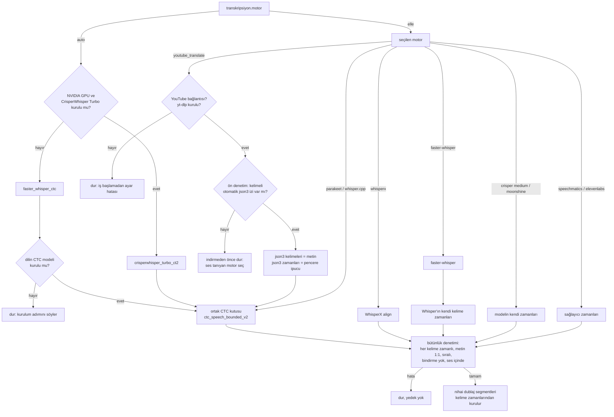

# Zaman kaynakları: her kelime zamanı nereden gelir

Her kelimenin başlangıç ve bitişini hangi bileşenin ürettiği, hangi kaynağın ne zaman kullanıldığı, neden, birbirine
göre kalitesi (yalnız ölçüm olan yerde) ve CTC hizalamasının nerede atlandığı. English:
[../engineering/timing-sources.md](../engineering/timing-sources.md).

Kanıt etiketleri [README.md](README.md) ile aynı: **ölçüldü**, **belgelendi**, **kayıt yok**. Kod tablosu (bu sayfanın ve
testlerinin tek kaynağı): `src/dublaj_hatti/bolum_20_transkripsiyon/zaman_kaynaklari.py`; testler:
`tests/test_zaman_kaynaklari.py`.

## 1. Kısa cevap

- Kelime zamanları sonraki her şeyi belirler: nihai dublaj segmentleri, TTS süre hedefleri, videonun yeniden
  zamanlanması ve altyazı.
- Tercih edilen kaynak **CTC zorlamalı hizalamadır** (forced alignment; WhisperX 3.8.6 üzerinden wav2vec2, politika
  `ctc_speech_bounded_v2`): ya ortak CTC kutusu ya da WhisperX'in kendi `align()` işlevi. Bkz.
  [kelime_hizalama.md](kelime_hizalama.md) ve [ADR 0005](../adr/0005-ctc-forced-alignment-only-time-source.md).
- Beş motor kelime zamanını **kendisi** verir ve CTC'ye hiç girmez: `faster-whisper` (yalnız elle seçilince), CrisperWhisper 2 Medium, Moonshine,
  Speechmatics, ElevenLabs Scribe v2 (§4).
- **Hazır altyazı** (YouTube'un otomatik `json3` altyazı izi) yalnız **metin** olarak kullanılır; zamanları yalnız
  hizalama penceresi ipucudur, hiçbir zaman kelime zamanı olmaz (§3).
- Kelime zamanı hiçbir yerde segment sınırından türetilmez. Yön her zaman kelimeden segmente doğrudur (§6).
- Hiçbir kaynak sessizce başka bir kaynağa düşmez. Eksik ya da tutarsız zaman işi mesajla durdurur
  ([ADR 0009](../adr/0009-fail-closed-no-silent-fallback.md)).
- Bu kelime zamanlarının sonra başına gelenler (nihai segmentler, çeviri, TTS yuvaları, altyazı), dosya dosya:
  [hat_akisi.md](hat_akisi.md#4-bir-aşamanın-çıktısı-ile-sonrakinin-girdisi-arasında-ne-değişir).

## 2. Motor başına (kaynak tarafı)

Motor `[transkripsiyon] motor` ayarıyla seçilir (`auto`, `yapilandirma.stt_secimi_coz` içinde çözülür). Motor sayfaları:
[../motorlar/](../motorlar/). Dil tespiti: [../tarifler/dil_tespiti.md](../tarifler/dil_tespiti.md). İzinli
birleşimler: [../tarifler/kombinasyonlar.md](../tarifler/kombinasyonlar.md).

| Motor | Kelime zamanı nereden gelir | Motor hizalayıcıya ne verir | Ne zaman seçilir |
|---|---|---|---|
| [crisperwhisper_turbo_ct2](../motorlar/crisperwhisper_turbo_ct2.md) | ortak CTC kutusu (kendi zamanları yalnız tanı için saklanır) | metin + kendi zamanlarından pencere | `auto`: NVIDIA GPU varsa ve kuruluysa; ya da elle |
| [faster_whisper_ctc](../motorlar/faster_whisper_ctc.md) | ortak CTC kutusu (Whisper'ın kendi zamanları yalnız tanılama için) | faster-whisper segmentleri | `auto`: GPU ya da CrisperWhisper Turbo yoksa; ya da elle (§2.1) |
| [faster-whisper](../motorlar/faster-whisper.md) | Whisper çapraz dikkat (cross-attention) zamanları (`word_timestamps=True`), **CTC yok** | – | yalnız elle |
| [whisperx](../motorlar/whisperx.md) | işçinin içinde WhisperX `align()` (wav2vec2 CTC) | ASR segmentleri | elle; ayrıca distil / Parakeet dil yedeğinin hedefi |
| [parakeet_cpu_align](../motorlar/parakeet_cpu_align.md) | ortak CTC kutusu | belirteç (token) zamanları; ≥ 1,0 sn boşluk yeni pencere açar (80 ms pay) | elle (İngilizce, işlemci) |
| [whisper_cpp_cpu_align](../motorlar/whisper_cpp_cpu_align.md) | ortak CTC kutusu | whisper.cpp segmentleri | elle (İngilizce, işlemci) |
| [youtube_translate](../motorlar/youtube_translate.md) | ortak CTC kutusu | json3 başlangıç ipuçlarından pencereler | elle, yalnız YouTube bağlantısı (§3) |
| [moonshine_medium_streaming_en](../motorlar/moonshine_medium_streaming_en.md) | akış modelinin kendi zamanları, **CTC yok** (deneysel) | – | elle (İngilizce) |
| [speechmatics](../motorlar/speechmatics.md) | sağlayıcı API'sinin kelime zamanları, **CTC yok** | – | elle, kendi anahtarınızla |
| [elevenlabs_scribe_v2](../motorlar/elevenlabs_scribe_v2.md) | sağlayıcı API'sinin kelime zamanları, **CTC yok** | – | elle, kendi anahtarınızla |

Kod: dağıtıcı `src/dublaj_hatti/bolum_00_omurga/core/dubber.py` içindeki `transcribe_and_align()`; CTC kutusu
`src/dublaj_hatti/bolum_30_hizalama_ve_segment/ctc_kelime_hizalama/` (`run_ctc_word_alignment`).

### Karar akışı

Öncelik, kodun söylediği haliyle: kaynaklar arasında çalışma anında bir sıralama yoktur. Her işte tek motor seçilir ve o
motorun kaynağı kullanılır; kaynaklar karıştırılmaz, iş ortasında değiştirilmez. Kendiliğinden yapılan seçimler yalnız
`auto` (yukarıda) ve belgelenmiş dil yedekleridir (yalnız İngilizce distil modelleri ve Parakeet, İngilizce olmayan
kaynakta WhisperX'e geçer; günlüğe yazılır; bkz. [transkripsiyon.md](transkripsiyon.md) §9).

### 2.1 `auto` yedeği: faster-whisper metni + CTC (`faster_whisper_ctc`)

- **Kural:** `auto`, NVIDIA GPU'da kuruluysa `crisperwhisper_turbo_ct2`'ye, değilse `faster_whisper_ctc`'ye çözülür
  (`yapilandirma.stt_secimi_coz`). Elle seçilen `faster-whisper` Whisper'ın kendi kelime zamanını korur, onda hiçbir şey
  değişmedi. Ayrım mevcut ayarla seçilir: `transkripsiyon.motor` (`faster_whisper_ctc` elle de seçilebilir); yeni anahtar
  eklenmedi.
- **Bağlantı:** whisper.cpp ve Parakeet ile aynı: faster-whisper eskisi gibi çalışır; segmentleri (metin, başlangıç,
  bitiş) CTC pencereleri olur; `run_ctc_word_alignment` her kelimeyi ölçer. Whisper'ın kendi kelime zamanları yalnız
  tanılama için yazılır (`faster_whisper_ctc/whisper_dogal_kelimeler.json`); `faster_whisper_ctc/report.json` pencere
  sayısını, iki kelime sayısını ve `text_identical` alanını tutar (Whisper `İstanbul'a`yı iki parçaya böler, CTC tek
  kelime tutar; daha az kelime metin değişikliği demek değildir).
- **Model yoksa sessiz düşüş yok:** `kaynak_dil` sabitse model iş başlamadan denetlenir (ayar hatası); dil `auto` ise
  eksik sabit modeller başta gerekçe olarak yazılır, iş dil tespitinden hemen sonra, hizalamadan önce durur. Mesaj adımı
  söyler: `scripts/kur.ps1 -Adim modeller` (yalnız hizalayıcılar: `python scripts/modelleri_indir.py --adim hizalama`).
  Sabit modeller: `en`, `tr`; isteğe bağlı sabit adım `-Adim hizalama-diller`: `ja`, `zh`. Başka dil bir kez
  bilerek `DUBLAJ_CEVRIMICI=1` ile çalıştırılır. Kaynak dil otomatikse faster-whisper işçisi tespitten hemen sonra,
  çözümlemeden önce denetler. `dubla kontrol`
  `hizalama (CTC): en=…, tr=…` satırını ve uyarı satırını yazar. Kod: `bolum_00_omurga/runtime/ctc_model_durumu.py`.
- **İşlemci bedeli (ölçüldü, birer koşu, `genel.cihaz = cpu`):** 23,8 sn İngilizce: tanıma ≈ 140 sn, CTC 16,5 sn (yükleme
  11 sn, hizalama 2,6 sn, konuşma sınırlama 1,8 sn). 60 sn Türkçe: tanıma ≈ 161 sn, CTC 42,9 sn (yükleme ≈ 10 sn,
  hizalama 18,6 sn, sınırlama 13,0 sn). CTC işlemcide transkripsiyon süresine ≈ %12–27 ekler; bu yüzden işlemcide de CTC
  yolu varsayılan kaldı, WhisperX'e (2. seçenek) gerek olmadı. Zaman aşımı: GPU'da 1800 sn; işlemcide
  `max(1800, 600 + 3 × ses saniyesi)` (belgedeki en kötü işlemci vakasını, 3,5 dk sesi ≈ 10 dk, kapsar).
- **Aynı koşularda kendi zamanı ↔ CTC (fark; referansa göre hata değil):** kelime başlangıçları İngilizcede ortalama
  145 ms / ortanca 102 ms (53 kelime), Türkçede 117 ms / 70 ms (eşleşen 93 kelime; en çok 1,38 sn) ayrışıyor.

## 3. Hazır YouTube altyazısı (`youtube_translate`)

Kod: `src/dublaj_hatti/bolum_20_transkripsiyon/youtube_json3_kaynagi/engine.py`. İsteğe bağlı ek `youtube`
(`pip install .[youtube]`). Yalnız hakkınız olan ya da izinli içerik; platform şartları kullanıcının sorumluluğundadır
(bkz. [../../ETHICS.md](../../ETHICS.md)).

### 3.1 Ne çekilir, nasıl

| Konu | Davranış |
|---|---|
| İz türü | **yalnız otomatik altyazı** (yt-dlp üst verisinde `automatic_captions`). Yüklenmiş/elle yazılmış altyazı (`subtitles`) okunmaz |
| Biçim | **yalnız `json3`**. `vtt`, `srv1/2/3`, `ttml`, `srt` hiçbir zaman yedek olarak kullanılmaz |
| Dil sırası | 1) videonun dili (`language`, yoksa `original_language`; bölge atılır: `fr-FR` → `fr`), 2) `en`, 3) diğer diller alfabetik. Dil bilgisi yoksa tercih `en` |
| yt-dlp çağrıları | üst veri için `YoutubeDL({"quiet": True, "no_warnings": True, "skip_download": True}).extract_info(url, download=False)`; seçilen iz adresi `YoutubeDL({"quiet": True, "no_warnings": True}).urlopen(url)` ile okunur. Yalnız yt-dlp'nin herkese açık, belgelenmiş API'si; başka uç nokta ve kendi imza işlememiz yok |
| Adres denetimi | ana makine `youtube.com` / `youtu.be` ya da alt alan adı (`www.`, `m.`) olmalı; benzer görünen adlar reddedilir |
| Ayrıştırıcı | olay başına `tStartMs`, parça başına `tOffsetMs` → `start_hint` (saniye); HTML varlıkları çözülür; çok kelimeli parça kelimelere bölünür ve hepsi aynı ipucunu alır; `[Music]`, `(laughs)`, `♪`, `♫` ve boş parçalar atılır; `tStartMs` olmayan olay yok sayılır; kelimeler ipucuna göre sıralanır. **`end` üretilmez** |
| Hizalama pencereleri | kelimeler cümle sonunda, > 2,5 sn boşlukta, > 18 sn genişlikte ya da 80 kelimede gruplanır; pencere = ilk ipucu − 0,25 sn … sonraki pencerenin ilk ipucu (sonuncusu: ses sonu) |
| Zamanlar | yalnız ortak CTC kutusundan (`report.json` içinde `word_timing_source = ctc_kelime_hizalama`, `json3_timing_role = alignment_window_hint_only`) |
| Zaman aşımı | `max(120, 90 + ses_dakikası × 8)` sn; belgelenmiş dayanak: başarılı hizalama maliyeti ses dakikası başına ≈ 2,8–3,1 sn |
| Baş dolgusu | uygulanmaz (ses tanıma çalışmaz); sıfır olmayan kaydırma hatadır |

### 3.2 Ne zaman kullanılır, ne zaman güvenilmez

- Yalnız kullanıcı `transkripsiyon.motor = "youtube_translate"` seçtiğinde ve kaynak bir YouTube bağlantısı olduğunda
  kullanılır. `auto` bunu asla seçmez. Bu motorla yerel dosya ayar hatasıdır.
- **Ön denetim (indirmeden önce):** `probe_youtube_json3`, `full_dub_pipeline` ve `transcript_only_pipeline`
  başında çalışır. Kullanılabilir otomatik json3 izi yoksa iş indirme, ses çıkarma ve ayrıştırmadan önce durur ve yerine
  seçilecek ses tanıma motorlarını söyler. Devam eden işte atlanır.
- **json3 zamanlarına kelime zamanı olarak hiç güvenilmez.** Yalnız pencere ipucudur (altyazı satırları gösterim
  zamanıdır, kelime sınırı değildir; belgelendi).
- Hizalanan kelime listesi json3 kelime listesiyle **bire bir** eşleşmelidir (büyük/küçük harf ve kenar noktalama yok
  sayılır); uyuşmazlık ya da zamanı olmayan kelime işi durdurur.
- Hizalamadan sonra küçük eksi süreler ve bindirmeler onarılır (ortadan bölme, en az 10 ms). Herhangi bir kelime
  **0,3 sn**'den fazla kayarsa iş durur (`zaman duzeltmesi guvenli siniri asti`): altyazı ile ses uyuşmuyordur (ör. müzik
  ya da farklı kurgu). Onarımdan sonra kalan eksi süre ya da bindirme de durdurur.
- İş başına hata ayıklama klasörü: `youtube_json3_transkripsiyon_kaynagi/` (ham json3, temiz kelimeler, hizalama girdisi,
  hizalanmış kelime ve segmentler, kalite raporu, rapor).

Ses tanımaya göre kalite: **kayıt yok** (json3 + CTC'nin bir ASR motoruyla ölçülmüş karşılaştırması saklanmadı). Metin
doğruluğu altyazı izinin doğruluğu kadardır.

## 4. Zamanını kendisi veren motorlar (CTC atlanır)

| Motor | CTC neden çalışmaz | Ölçülmüş karşılaştırma |
|---|---|---|
| faster-whisper (yalnız elle) | Hizalama adımı olmadan hızlı yol olarak ve CTC modeli olmayan diller için tutulur. `auto` bunu kullanmaz; yedeği `faster_whisper_ctc`'dir (§2.1) | 10 dosyalık İngilizce derlemde (3,9 sa) CTC zamanlı motorlarda kelime başı ortalama mutlak hata (MAE) 28–51 ms ve 0 sıfır süreli kelime; distil'in kendi zamanlarında 106–126 ms ve 611–899 sıfır süreli kelime ([transkripsiyon.md](transkripsiyon.md) §1). distil olmayan faster-whisper'ın kendi zamanı ↔ CTC: **kayıt yok** |
| moonshine_medium_streaming_en | Deneysel. Parça sınırlarında metin hatası da olduğu için yalnız CTC ile yeniden hizalama çözmez; geri kayan başlangıç işi durdurur (`MoonshineDeneyselHatasi`), zamanlar asla düzenlenmez | [transkripsiyon.md](transkripsiyon.md) §6 |
| speechmatics | Sağlayıcı kelime zamanı döndürür; kodda CTC geçişi yok. CTC'nin atlanma gerekçesi: **kayıt yok** | belgelendi: WhisperX + CTC'ye göre ≈ 100 ms ortalama fark, kelimelerin %75'i 100 ms içinde; 60 sn video ≈ 6 sn'ye karşı ≈ 40 sn (örnek sayısı kayıtlı değil) |
| elevenlabs_scribe_v2 | Sağlayıcı kelime zamanı döndürür; CTC geçişi yok. Gerekçe: **kayıt yok** | **kayıt yok** |

Beşi de ortak denetimlerden (§5) ve nihai segment kurucudan geçer.

## 5. Her kaynağın geçtiği denetimler

- Hizalanmış veride `check_word_overlaps`; `refine_segment_times_from_words` her tanıma segmentini ilk kelimenin
  başlangıcına ve son kelimenin bitişine çeker.
- Nihai dublaj segmentleri her zaman düz kelime listesinden yeniden kurulur (`nihai_dublaj_segmentlerini_olustur`):
  boşluk eşiği 1,0 sn, en çok 150 kelime, noktalama önceliği `. ? ! ,`. Motorun segment sınırları yeniden kullanılmaz.
- CTC kutusu son denetimleri: her kelime zamanlı, kelime düşmemiş, sıra korunmuş, aşırı uzun kelime yok, yutulmuş
  sessizlik yok, tekdüze artan, bindirme yok, ses sonunu aşan yok ([kelime_hizalama.md](kelime_hizalama.md) §3–4).
- Bütünlük hatası işi durdurur; ara kayıt parmak izleri CTC sınır politikasını içerir, politika değişince eski
  transkriptler bilerek geçersiz olur.

## 6. Segment zamanı ve kelime zamanı

- **Hiçbir kod kelime zamanını segment zamanından türetmez** (karakter ya da süre oranıyla bölme yok). Bu, ölçüm değil
  tahmin olduğu için reddedildi ([kelime_hizalama.md](kelime_hizalama.md) §2).
- Motor yalnız segment (whisper.cpp, WhisperX ASR çıktısı) ya da yalnız metin (`hizala`, json3) verdiğinde segmentler
  **hizalama penceresi** olarak kullanılır; içindeki kelimeleri CTC ölçer.
- Zamanı olmayan kelimeler WhisperX işçisinde ve CTC kutusu işçisinde düşürülür; json3 ve CrisperWhisper Turbo sonra
  bire bir metin denetiminde durur.
- `dubla hizala <ses> <metin>` (aşama komutu) bilinen metni hizalar: `.txt` dosyası tüm ses üzerinde tek penceredir;
  transkript JSON'u kendi segment zamanlarını pencere olarak kullanır. Yerel `.srt` / `.vtt` dosyası zaman ya da metin
  kaynağı olarak **kabul edilmez** (hattın önceki sürümünde de böyle bir girdi yoktu).

## 7. Üretilen taraf: dublajın altyazı zamanları

- Kaynak: video zaman çizelgesine taşınmış, doğrulanmış aday kelime zaman çizelgesi (Supertonic adayları); yoksa nihai
  dublaj izinin zorlamalı hizalaması (`audio_new_timeline.wav` + nihai segment metinleri). Hizalama yoksa iş durur
  ([video_altyazi_ve_devam.md](video_altyazi_ve_devam.md) §4).
- Üretici `subtitle_timing_contract.json` dosyasını TTS motor adıyla yazar; altyazı çizici geri okur ve motoru, dili,
  zaman kaynağını, yöntemi ve kelime sayısını denetler.
- Her segment TTS motoru (`supertonic`, `voxcpm2`, `xtts`) desteklenen sözleşme motorudur ve kendi hata ayıklama klasörü
  vardır (`<motor>_timing_debug/`). Bu repoda daha önce sözleşme yalnız `supertonic`/`xtts`'i biliyordu ve okuyan taraf
  her zaman `supertonic` bekliyordu; yakılmış altyazı VoxCPM2'de (desteklenmeyen motor) ve XTTS'te (motor uyuşmazlığı)
  hata veriyordu; düzeltildi, `tests/test_zaman_kaynaklari.py` sınar.

## 8. Hattın önceki sürümüyle farklar

| Konu | Önceki sürüm | Bu repo |
|---|---|---|
| json3 iz seçimi, ayrıştırıcı, pencereler, onarım, 1:1 denetim, zaman aşımı | – | aynı (işlev işlev karşılaştırıldı) |
| json3 ön denetimi | GUI ve sohbet botu menüleri sıraya almadan önce yokluyordu; GUI sonra motoru Parakeet'e çeviriyordu | yoklama hattın içinde (CLI, GUI, web, bot hepsi); mesajla durur, motor değiştirilmez |
| YouTube adres denetimi | ana makinede alt dize eşleşmesi | tam ana makine ya da alt alan adı |
| json3 modülünde CTC ve `soundfile` içe aktarımı | modül yüklenirken | tembel (ayrıştırıcı ve iz seçimi numpy olmadan sınanabilir) |
| Turbo ara kaydında onarım kodunun parmak izi | json3 modülünü gösteriyordu (onarım oradaydı) | `ctc_kelime_hizalama/zaman_onarimi.py`'yi, yani Turbo'nun gerçekten çalıştırdığı kopyayı gösterir; json3 kopyası durur, bir test ikisinin aynı davrandığını denetler |
| Diğer bütün motor zaman yolları | – | paket yolları, gizli alt süreç pencereleri ve Moonshine kronoloji durdurması dışında aynı |

## 9. Açık kalanlar

- Kapandı: CrisperWhisper yokken `auto` faster-whisper'ın kendi zamanlarını kullanıyordu, ADR 0017 ve kurulum sayfaları
  "faster-whisper + CTC" diyordu; artık kod sayfalara uyuyor (`faster_whisper_ctc`, §2.1).
- CTC adımının işlemci bedeli dil başına tek kısa koşuya dayanıyor; uzun seste işlemci süresi ölçülmedi.
- json3 + CTC, CrisperWhisper Medium dikkat zamanları ve ElevenLabs kelime zamanları için CTC'ye karşı ölçüm yok.
- Zaman kanıtı vermeyen motorlar için VAD penceresi hazırlama bir kuraldır, hiç ölçülmedi ([kelime_hizalama.md](kelime_hizalama.md) §8).
